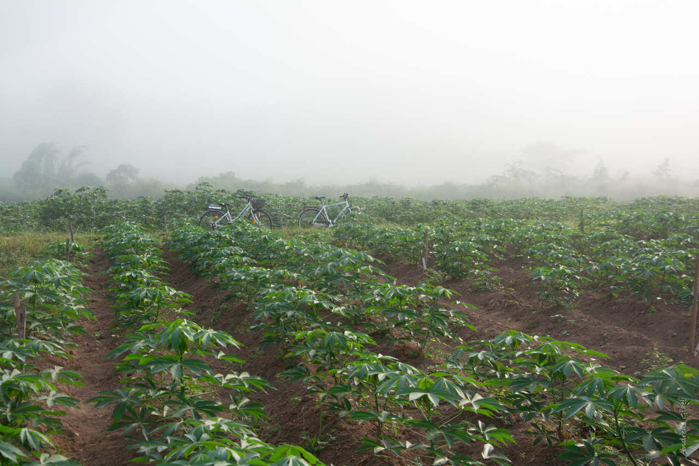

 
{width=700}

 
The data we will be working on are DNA sequencing data and RNA sequencing data from cassava cultivars.
 
The paired end DNA sequences were retrieved from the cassava cultivar called [TMEB117](https://www.researchgate.net/publication/376387151_Haplotype-resolved_genome_of_heterozygous_African_cassava_cultivar_TMEB117_Manihot_esculenta), a cultivar whose genome is now known and that, due to its susceptibility to certain cassava diseases, can be used as a reference for studying virus resistance mechanisms in cassava.
 
The paired end RNA sequencing data comes from a cassava genotype called [TMEB419](https://www.agrobiotech.bio/en/cassava/57-manioc.html). This cultivar was bred to be highly resistant to various cassava viruses and is used commercially.
 
The reference sequence is chromosome01 from the latest cassava genome build [V8](https://phytozome-next.jgi.doe.gov/info/Mesculenta_v8_1). To save time and computing power we use only this one chromosome.
 
Special thanks to Andreas Gisel for providing these samples (and the picture above)!
 
# What files do we have?
 
| File | What it contains |
|------|------------|
| `TMEB117_R1_frac.fastq`, `TMEB117_R2_frac.fastq` | DNA sequencing: paired-end reads of cultivar TMEB117 (a fraction of the full run) |
| `TMEB419RNA_frag_R1.fastq`, `TMEB419RNA_frag_R2.fastq` | RNA sequencing: paired-end reads of cultivar TMEB419 (a fragment of the full run) |
| `chromosome01.fasta` | Reference sequence: chromosome 1 of the cassava genome V8 |
| `Mesculenta_671_v8.1.gene_exons.gff3` | Gene annotation for the reference, in GFF3 format |
| `Mesculenta_671_v8.1.gene_exons.gtf` | The same annotation in GTF format, which STAR needs |
 
# Data location
 
The data is on the server in the course directory, in the folder `teachers/course_data/NGS/`. You find the course directory in Canvas.
