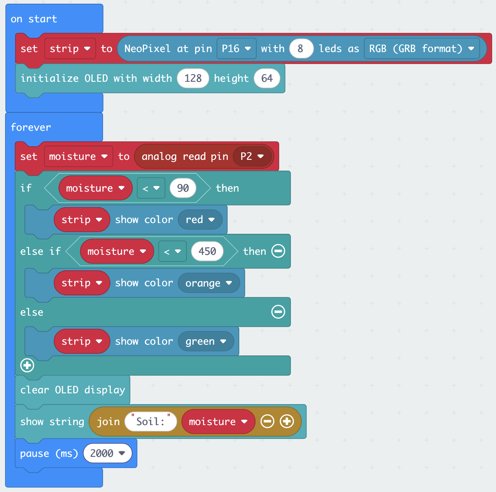

You work in your team of 4–5 throughout, with one micro:bit and one Smart Health Kit per team. Take turns at the keyboard: every team member should understand each step before you move on.

To look up a sensor or actuator, use [The kit: sensors and actuators](kit.qmd). When something does not work, see [Troubleshooting](troubleshooting.qmd).


## Team roles

Assign roles at the start of each exercise and rotate them.

| Role | What they do |
|------|-------------|
| **Driver** | Operates the keyboard in MakeCode |
| **Navigator** | Reads the instructions aloud and tells the driver what to do |
| **Hardware lead** | Connects and handles sensors and cables |
| **Checker** | Watches the device output and spots when something is wrong |
| **Documenter** | Notes down observed values, thresholds and quirks for the Canvas lab quiz |

## The exercises

| | Exercise | Sensor | Output | In the greenhouse |
|-|----------|--------|--------|-------------------|
| 1 | [Push the button](#ex1) | built-in (buttons, temperature) | LED matrix | your first complete device |
| 2 | [Greenhouse climate monitor](#ex2) | DHT11 (temperature + humidity) | OLED + LED matrix | when to ventilate |
| 3 | [Irrigation alarm](#ex3) | soil moisture | OLED + Rainbow LED | when to water |
| ★ | [Mini challenge](#challenge) | your choice | your choice | build your own device |

## Setup {#setup}

Do not rush this: a broken setup wastes more time than a careful one.

### Step 1: Connect the hardware

1. Slot the micro:bit into the Sensorbit edge connector: the USB port faces **up**, the LED matrix faces **out**
2. Press it firmly until it seats fully: a loose connection causes intermittent failures
3. Connect the micro:bit to your laptop with the USB cable
4. The micro:bit lights up and shows a startup animation: this confirms it has power

::: {.callout-important}
## Remember the wiring: G to G, V to V, S to S
Every sensor in this lab connects with a three-wire cable. The Sensorbit's pin rows are labelled **G** (ground), **V** (3.3 V power) and **S** (signal), and so are the pins on each sensor. Connect G to G, V to V, S to S, every time. By convention the wires are black (G), red (V), and yellow or another colour (S), but **trust the printed labels, not the colours**.
:::

### Step 2: Open MakeCode

1. Open a browser and go to [**makecode.microbit.org**](https://makecode.microbit.org){target="_blank"}
2. Click **New Project**
3. Name it `lab-session` and click **Create**
4. You see the three-panel interface: simulator (left), toolbox (middle), workspace (right)

### Step 3: Flash a test program

This confirms your USB connection works before you add anything else.

1. In the toolbox, find the **Basic** category
2. Drag a **show string** block into the `on start` block already on the workspace
3. Type `Ready` in the text field
4. Click the **Download** button (bottom left of the workspace)
5. A `.hex` file is saved to your computer: drag it onto the **MICROBIT** drive that appeared in Finder or File Explorer
6. The orange LED on the micro:bit flashes while it writes: wait for it to stop
7. `Ready` should scroll across the LED matrix

{fig-align="center" width="55%"}

::: {.callout-important}
## ✓ Checkpoint
`Ready` scrolls across the LED matrix. If it does not, check the [Troubleshooting](troubleshooting.qmd) page or ask a teacher before going further.
:::

### Step 4: Add the Elecfreaks extension

1. In the toolbox, scroll to the bottom and click **Extensions**
2. In the search box type `smarthome` and press Enter
3. Select the **smarthome** package from Elecfreaks
4. Close the extensions panel: you now see new categories at the bottom of the toolbox, including **SmartHome**, **OLED** and **Neopixel**

::: {.callout-tip}
You add the extension once per project. When you start a new project later, add it again.
:::

## Exercise 1: Push the button {#ex1}

Before wiring anything, you build a complete working device using only what is already on the micro:bit: two buttons, a temperature sensor, an accelerometer and the LED matrix. Within ten minutes, your team has a pocket thermometer.

**What you will build**

- Press **button A** → a heart icon appears
- Press **button B** → the current temperature is shown
- **Shake** the micro:bit → the display clears

No wiring. No extension blocks. Everything is built in.

### Building the program

Keep working in your `lab-session` project from the [setup](#setup).

**Step 1: React to button A**

1. From **Input**, drag an `on button A pressed` block onto the workspace. Notice it has the same shape as `on start` and `forever`: a container with a smooth top edge and no notch, so it cannot snap inside or underneath another block. It always starts its own stack on the workspace. This is an **event block**: the blocks you place inside it run only when that event happens.
2. From **Basic**, put a `show icon` block inside it and pick the heart.

**Step 2: Show the temperature on button B**

1. From **Input**, drag another `on button A pressed` block onto the workspace, and **change it to button B**.
2. From **Basic**, put a `show number` block inside it
3. From **Input**, find the `temperature (°C)` block. Notice its **oval shape**: oval blocks are **reporter blocks**. They return a value and must be plugged into a slot, not placed on their own line. Plug it into the `show number` slot.

**Step 3: Clear on shake**

1. From **Input**, drag an `on shake` block onto the workspace
2. From **Basic**, put `clear screen` inside it

**Step 4: Download and test**

Your workspace should now look like this: four separate stacks, each starting with its own container block.

{fig-align="center" width="50%"}

Flash, then press A, press B, shake. All three should respond.

::: {.callout-tip}
This program has **no `forever` loop at all**. Event blocks sit and wait; the micro:bit does nothing until a button is pressed or the board is shaken. Remember this: the next exercise uses the opposite approach.
:::

::: {.callout-important}
## ✓ Checkpoint
- Button A shows the heart
- Button B shows a temperature
- Shaking clears the display (best seen after pressing A)
:::

::: {.callout-note collapse="true"}
## JavaScript equivalent

```javascript
input.onButtonPressed(Button.A, function () {
    basic.showIcon(IconNames.Heart)
})
input.onButtonPressed(Button.B, function () {
    basic.showNumber(input.temperature())
})
input.onGesture(Gesture.Shake, function () {
    basic.clearScreen()
})
basic.showString("Ready")
```
:::

### Discussion: your first sensor limitation

Compare the temperature your micro:bit shows with a room thermometer, or with another team's micro:bit.

**Question for your team:** The built-in sensor measures the temperature of the **processor chip**, not the air. The chip warms up as it works. What does this mean for the reading? Would this "thermometer" be good enough to decide when to ventilate a greenhouse? Note your observation: the gap between what a sensor *actually measures* and what you *want to know* comes back in every exercise.

### Extension challenge (if you finish early)

Add an `on button A+B pressed` event that scrolls your team's name across the display.

## Exercise 2: Greenhouse climate monitor {#ex2}

A tomato greenhouse should stay between about 18 °C and 28 °C. Above that, the plants are stressed and the roof vents should open. You are building a device that hangs among the plants and shows temperature and humidity continuously, so the grower can check conditions at a glance, and that raises an alarm when it gets too hot.

**What you will build**

- Every 2 seconds: read temperature and humidity from the DHT11 sensor
- Display both values on the OLED screen
- If the temperature is above your alarm threshold: the LED matrix shows a warning icon

### Hardware

This is your first **external** sensor: one cable, three wires, and the wiring rule from the [setup](#setup).

1. Connect the **DHT11** sensor to the Sensorbit port labelled **P1**. G to G, V to V, S to S.
2. Plug the **OLED screen** into the Sensorbit's **IIC** socket

::: {.callout-tip}
You will not find a P0 port on the Sensorbit: P0 is wired to the board's built-in buzzer and headphone jack. The G/V/S ports start at P1.
:::

### Building the program

Start a new project (`climate-monitor`). Add the Elecfreaks extension: extensions are per-project, so you need it again here.

**Step 1: Initialise the OLED in `on start`**

The OLED must be initialised once before you can write to it.

1. In the **OLED** category, find the block labelled something like `initialize OLED width 128 height 64`
2. Drag it into the `on start` block on the workspace

**Step 2: Store the DHT11 readings in variables**

The DHT11 block in the SmartHome category is a **reporter block**: the same oval shape as the built-in `temperature (°C)` block you used in [Exercise 1](#ex1). It reads the sensor and returns the measurement in one go. It has two dropdowns: one to select the pin, one to select the measurement (temperature or humidity).

1. From **Variables**, click **Make a Variable** and create one called `temperature`
2. Create a second variable called `humidity`
3. In the `forever` block, add a `set temperature to` block (from **Variables**). From **SmartHome**, find the `DHT11 sensor [pin] temperature(°C) value` block, set the pin to **P1**, and plug it into the value slot of `set temperature to`.
4. Below that, add `set humidity to` and plug in a second `DHT11 sensor P1 humidity(0~100) value` block: same block, different measurement selected in the dropdown.

**Step 3: Display on the OLED**

1. From **OLED**, add a `clear OLED display` block: this wipes the screen before writing new values
2. To show the temperature: from **OLED**, add the `show string` (or `show number`) OLED block. Use the **Text → join** block (in **Advanced → Text**) to combine the label `"Temp: "`, the `temperature` variable and the unit `" C"` into one line.
3. Repeat for humidity: `"Hum: "` + `humidity` + `" %"`

::: {.callout-tip}
If the `join` block is unfamiliar, a simpler approach is to put `temperature` on its own line with just `show number` and `humidity` on the next. Labels can go on separate lines above each number.
:::

**Step 4: Add a temperature alarm**

First flash the program as it is and read the room temperature on the OLED. The Documenter writes it down.

1. From **Logic**, add an `if / then / else` block, placed **before** the `clear OLED display`
2. Set the condition: `temperature > 28` (the upper limit for our tomatoes). To test it in the classroom, use a threshold 2–3 degrees above the room temperature you just read.
3. In the `if` branch: from **Basic**, add `show icon` and pick the warning or exclamation symbol
4. In the `else` branch: from **Basic**, add `clear screen`

**Step 5: Wait 2 seconds**

At the very end of the `forever` block:

1. From **Basic**, add `pause (ms)` set to **2000**

This is essential: the DHT11 can only be read once every two seconds. Without the pause, you get read errors.

::: {.callout-tip}
## Two patterns, compared
[Exercise 1](#ex1) used **events**: code that waits for something to happen. This exercise uses **polling**: a `forever` loop that reads the sensor again and again and reacts to what it finds. Events only exist for the micro:bit's built-in inputs; external sensors must be polled. You now know both fundamental patterns of microcontroller programming.
:::

**Step 6: Download and test**

{fig-align="center" width="55%"}

Download and flash the program. Then:

- Check that the OLED shows values
- Breathe gently on the DHT11: temperature and humidity should increase slightly
- Warm the sensor in your hand: the temperature should rise above your alarm threshold and the warning icon should appear

::: {.callout-important}
## ✓ Checkpoint
- The OLED shows temperature and humidity
- Values change (even slightly) when you breathe on the DHT11
- The LED matrix shows the warning icon when the temperature exceeds your threshold, and clears when it drops below
:::

::: {.callout-note collapse="true"}
## JavaScript equivalent

```javascript
let humidity = 0
let temperature = 0
OLED.init(128, 64)
basic.forever(function () {
    temperature = smarthome.dht11Sensor(DigitalPin.P1, smarthome.DHT11_state.DHT11_temperature_C)
    humidity = smarthome.dht11Sensor(DigitalPin.P1, smarthome.DHT11_state.DHT11_humidity)
    if (temperature > 28) {
        basic.showIcon(IconNames.No)
    } else {
        basic.clearScreen()
    }
    OLED.clear()
    OLED.writeStringNewLine("Temp:" + temperature + " C")
    OLED.writeStringNewLine("Hum:" + humidity + " %")
    basic.pause(2000)
})
```

Exact function names depend on the smarthome extension version: if the above does not compile, check the block names shown in the MakeCode toolbox.
:::

### Discussion: accuracy and fitness for purpose

The DHT11 has an accuracy of **±2 °C** and **±5 %** humidity, and it measures humidity only up to **90 %**. Your alarm fires at **28 °C**.

1. The true temperature is 27 °C, but the sensor reads 2 °C too high. What does your program see, and what does it do?
2. The true temperature is 29 °C, but the sensor reads 2 °C too low. Does the alarm fire?

::: {.callout-tip collapse="true"}
## Answer
1. The program sees 29 °C and raises the alarm, although it is not too hot: a **false alarm**.
2. The program sees 27 °C and stays quiet, although it is too hot: a **missed alarm**.

Close to the threshold, the sensor's error decides what happens, not the real temperature.
:::

**Question for your team:** Is this device good enough to control the vents of a greenhouse? What would a more reliable design need? Note your answer: it appears in the Canvas lab quiz.

**Question for your team:** Is this device good enough to control the vents of a greenhouse? What would a more reliable design need? Note your answer: it appears in the Canvas lab quiz.

### Extension challenge (if you finish early)

Add a humidity alarm. Humidity above about 85 % for many hours favours fungal diseases such as grey mould (*Botrytis*). Extend your `if / else` to an `if / else if / else` that shows a different icon, or writes `"HUMID!"` to the OLED, when humidity is above 85. Breathe on the sensor to test it. What happens close to the sensor's 90 % limit?

## Exercise 3: Irrigation alarm {#ex3}

A greenhouse grower wants to avoid over- and under-watering a seedling bed. Rather than checking by hand every day, a moisture sensor gives a continuous reading. You build a device that colour-codes a Rainbow LED strip to show the soil status at a glance: red (dry), amber (moist), green (wet), so the grower knows immediately whether to water.

**What you will build**

- Soil moisture sensor read continuously
- Raw numeric value shown on the OLED
- Rainbow LED strip: **red** when dry, **amber** when moist, **green** when wet enough
- Thresholds calibrated by you during the exercise

### Hardware

1. Connect the **soil moisture sensor** to the Sensorbit port labelled **P2**
2. Connect the **Rainbow LED strip** to the Sensorbit port labelled **P16**
3. Keep the **OLED** in the IIC socket

### Building the program

Start a new project (`irrigation-alarm`). Add the Elecfreaks extension.

**Step 1: Set up the Rainbow LED strip in `on start`**

The Rainbow LED strip is controlled with **Neopixel** blocks, which came with the Elecfreaks extension.

1. From **Variables**, create a variable called `strip`
2. From **Neopixel**, drag the block `set strip to Neopixel at pin P16 with 8 leds as RGB (GRB format)`
3. Set `strip` to this block: this initialises the LED strip

Also add the OLED initialiser: `initialize OLED width 128 height 64`.

**Step 2: Read the soil moisture sensor in `forever`**

The soil moisture sensor is an **analog** sensor. No special extension block is needed: you read it directly from a pin, and you get a number on a scale.

1. Create a variable called `moisture`
2. From **Advanced → Pins**, drag an `analog read pin P2` block and set `moisture` to it
3. From **OLED**, clear the OLED and display the value: label `"Soil: "` joined to `moisture`

{fig-align="center" width="85%"}

::: {.callout-tip}
The analog read returns a number between **0 and 1023**. **Higher value = wetter.** Wet soil conducts electricity well, so more current reaches the signal pin and the number is high. Dry soil conducts poorly: in open air the reading sits near **0**. Run the program and check your own readings before setting thresholds.
:::

**Step 3: Discover your thresholds**

Before adding colour logic, flash and test the raw readings:

1. Hold the sensor probes in the **air**: note the value
2. Press your **fingers firmly across both metal probes**: this simulates wet, conductive soil. Note the value.
3. Lightly touch the probes: note the intermediate value

These three readings give you the range for your thresholds. The Documenter writes them down; you need them for the lab quiz.

| Condition | Raw value |
|-----------|-----------|
| Air (dry) | |
| Light contact (moist) | |
| Firm contact (wet) | |
| Your dry/moist threshold | |
| Your moist/wet threshold | |

**Step 4: Colour-coded response**

Add an `if / else if / else` block after the moisture read:

```
if moisture < [your dry/moist threshold]:
    strip show colour red

else if moisture < [your moist/wet threshold]:
    strip show colour orange

else:
    strip show colour green
```

Note the direction: **low readings mean dry**, so the *first* check catches values *below* your dry threshold.

Use your observed values from Step 3 as the thresholds. Use the **Neopixel** block `strip show colour` in each branch.

**Step 5: Slow the loop down**

At the very end of the `forever` block, add a `pause (ms)` block (from **Basic**) set to **2000**.

Unlike the DHT11, the soil moisture sensor doesn't *need* this: it can be read as fast as you like. The pause is for the humans: without it, the OLED value updates many times per second and is hard to read.

**Step 6: Download and test**

Flash, then check that all three colours appear as you move between dry, light contact and firm contact.

{fig-align="center" width="55%"}

::: {.callout-important}
## ✓ Checkpoint
- The OLED shows a number that changes with contact
- The Rainbow LED goes red in air, amber with light contact, green with firm contact (or similar: your thresholds may give a different boundary)
- You have written down your threshold values
:::

::: {.callout-note collapse="true"}
## JavaScript equivalent

```javascript
let moisture = 0
let strip = neopixel.create(DigitalPin.P16, 8, NeoPixelMode.RGB)
OLED.init(128, 64)
basic.forever(function () {
    moisture = pins.analogReadPin(AnalogReadWritePin.P2)
    if (moisture < 90) {
        strip.showColor(neopixel.colors(NeoPixelColors.Red))
    } else if (moisture < 450) {
        strip.showColor(neopixel.colors(NeoPixelColors.Orange))
    } else {
        strip.showColor(neopixel.colors(NeoPixelColors.Green))
    }
    OLED.clear()
    OLED.writeStringNewLine("Soil:" + moisture)
    basic.pause(2000)
})
```

Replace 90 and 450 with the threshold values you observed on your hardware.
:::

### Discussion: calibration and drift

The raw reading is a number between 0 and 1023. You just set your thresholds based on a minute of testing with your fingers.

**Question for your team:** The grower leaves this sensor in the seedling bed for three months. The probe tips corrode. What happens to the readings? Would your thresholds still be valid? And would they be valid in a different potting soil, or after fertilising (salts conduct electricity too)? What would you need to do to make this device reliable for long-term use?

### Extension challenge

**Graduated display.** Instead of showing every LED in the same colour, make the number of lit LEDs match the moisture level: 0 LEDs for bone dry, all 8 for saturated. This gives the grower more detail than three categories. Use the **Neopixel** block `strip set pixel color at [n] to [colour]` inside a loop.

## ★ Mini challenge {#challenge}

Aim to start this about 40 minutes before the end of the session.

Choose one scenario and build as much as you can. You do not need to finish: the goal is to sketch the logic, start implementing, and find out where you get stuck.

| | Scenario | Suggested sensors | Suggested outputs |
|-|----------|-------------------|-------------------|
| A | **Plant health station** | DHT11 + soil moisture | OLED shows both readings; Rainbow LED summarises the overall status |
| B | **Automatic vent** | DHT11 | Servo turns to "open" above your temperature threshold and back to "closed" below it |
| C | **Greenhouse fan** | DHT11 | Fan runs while it is too warm or too humid; OLED shows why |
| D | **Seed storage monitor** | DHT11 | OLED shows the readings; Rainbow LED turns red when it is too humid for stored seed |
| ★ | **Free choice** | Any from the kit | Any combination of outputs |

::: {.callout-tip}
## Using the servo or the fan
The servo and the fan are not covered in the exercises. Look for their blocks in the **SmartHome** category, or use **Advanced → Pins** (`servo write pin … to …` for the servo). Plug them into a free port: P8, P12 or P13–P15.

Motors draw a lot of current. If the micro:bit restarts as soon as the motor runs, the USB power is not enough: ask a teacher for a battery pack.
:::

For your chosen scenario:

1. **Agree the behaviour:** what is the trigger? What is the response?
2. **Sketch the logic:** write pseudocode or draw a simple flowchart on paper before touching the keyboard
3. **Build what you can:** start with the first sensor working, then add the next part
4. **Note your sticking point:** what is the first thing that didn't work, and why?

## Before you leave

1. **Save your code.** In MakeCode, click the save icon (floppy disk) to download the `.hex` file for each project. You can also copy the project URL from the browser address bar to reopen it later.
2. **Disconnect carefully.** Unplug the USB cable before removing the micro:bit from the Sensorbit.
3. **Return the sensors to the foam tray.** Each sensor has its own slot.

::: {.callout-tip}
## Lab quiz
Take the **lab quiz in Canvas**. The questions ask about what you observed: your threshold values, the limitations you noticed, and what you would change. Your Documenter's notes are the answers.
:::
