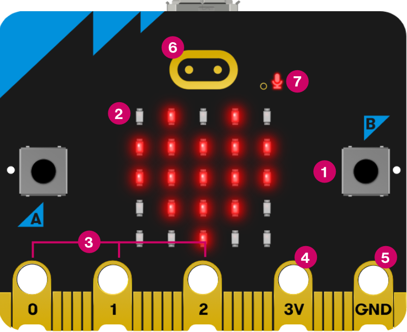
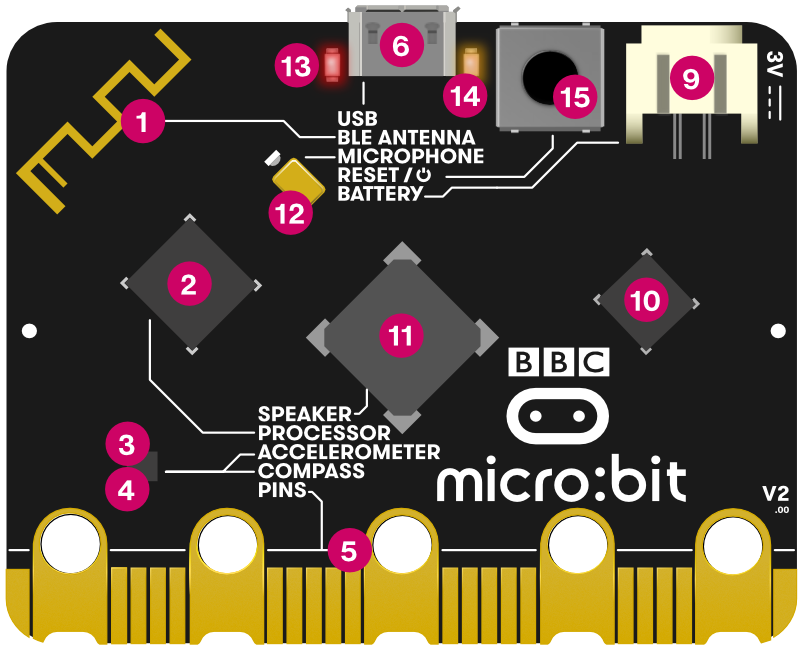
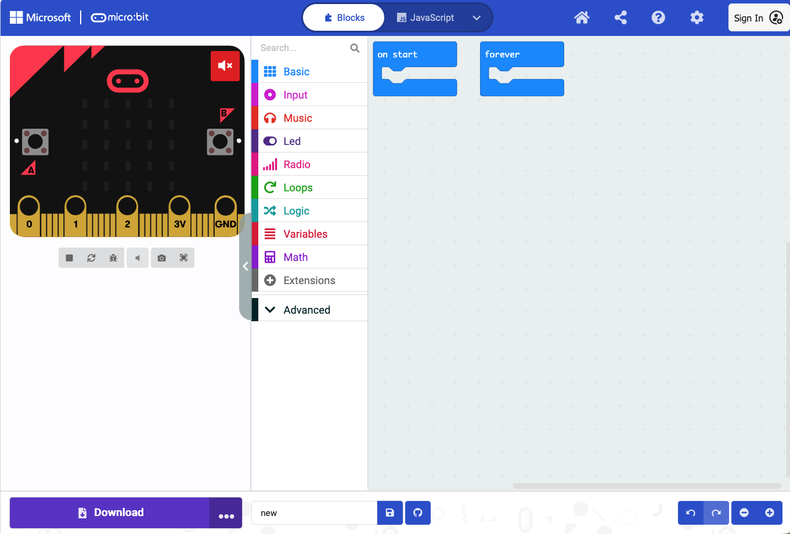

## This lecture

[]{style="display:block; height:1.5em"}

1. What is a microcontroller?
2. Signals: digital, analog and serial
3. Sensors and actuators for a greenhouse
4. The kit: micro:bit and Sensorbit
5. Programming with MakeCode
6. In class

# What is a microcontroller?

## The routine in a greenhouse

[]{style="display:block; height:1.5em"}

Think about what a farmer does every morning in a greenhouse:

- They sense: check the thermometer, feel the soil
- They decide: is it too warm? too dry?
- They act: open a vent, water the bed

. . .

A microcontroller does the same, with electricity instead of judgement. It never sleeps in, and it checks every two seconds.

## Sense → decide → act

[]{style="display:block; height:1.5em"}

Microcontroller system

1. A sensor measures something and sends a signal to the microcontroller
2. The program reads the signal and decides what to do
3. The microcontroller sends a signal to an actuator, which does something in the world

. . .

**Example:** the greenhouse gets too warm.
The temperature sensor reads 31 °C, the program checks "above 28 °C?", and a servo opens the roof vent.

## What is a microcontroller?

[]{style="display:block; height:1.5em"}

A small, self-contained computer on a single chip:

- a processor: runs the instructions, one step at a time
- memory: holds the program and temporary data
- input/output pins: where signals come in from sensors and go out to actuators

. . .

They are cheap, low-power and reliable, so they suit places with little staff and unreliable power: irrigation timers, incubators, fridges, insulin pumps.

## The BBC micro:bit: front

[]{style="display:block; height:1.5em"}

:::: {.columns}
::: {.column width="50%"}
{width="90%"}
:::
::: {.column width="50%"}
1. buttons A and B
2. LED display: 5×5 LEDs, also a light sensor
3. pins 0, 1, 2: inputs and outputs
4. 3V pin: power
5. GND pin: ground
6. touch logo: touch sensor
7. microphone LED
:::
::::

::: notes
Credit-card sized learning board. The pins along the bottom edge make it extensible: we plug it into the Sensorbit.
:::

## The BBC micro:bit: back

:::: {.columns}
::: {.column width="55%"}
{width="100%"}
:::
::: {.column width="45%"}
::: {.small}
1. radio and Bluetooth antenna
2. processor, with the temperature sensor
3. compass
4. accelerometer: movement and tilt
5. pins: the edge connector
6. micro USB socket

<!-- -->

9. battery socket
10. USB interface chip
11. speaker
12. microphone
13. red power LED
14. yellow USB LED: flashes while a program is copied
15. reset and power button
:::
:::
::::

# Signals

## Two types

[]{style="display:block; height:1.5em"}

:::: {.columns}
::: {.column width="50%"}
**Digital**

- two states: on/off, 1/0
- like a light switch
- a button press, "motion / no motion"
:::
::: {.column width="50%"}
**Analog**

- a continuous scale
- like a dimmer switch
- soil moisture, light level
- converted to a number by an analog-to-digital converter (ADC): on the micro:bit, 0 to 1023
:::
::::

## A third type: serial

[]{style="display:block; height:1.5em"}

- Some sensors send a fast, timed series of digital pulses that together encode a number: like morse code and not a light switch.
- We have one in our kit: the DHT11 sends temperature and humidity in one stream of 40 pulses.
- A software library (the Elecfreaks extension) decodes it: you use one block and get a number.

. . .

As programmers we need to know the signal type.

# Sensors and actuators for a greenhouse

## Sensors you will encounter today (1/2)

[]{style="display:block; height:1.5em"}

Measuring the environment:

| Sensor | What it measures | Signal type | Example use |
|--------|-----------------|-------------|-------------|
| DHT11 | Temperature and humidity | Digital (serial) | Monitor storage conditions for vaccines or grain |
| Soil moisture | Water content in soil | Analog | Trigger irrigation when soil is too dry |
| UV | Ultraviolet light intensity | Analog | Measure sun exposure; optimise plant growth |
| MQ3 alcohol | Alcohol vapor in air | Analog | Screen for alcohol in breath; monitor fermentation |

## Sensors you will encounter today (2/2)

[]{style="display:block; height:1.5em"}

Detecting events:

| Sensor | What it measures | Signal type | Example use |
|--------|-----------------|-------------|-------------|
| PIR | Movement of warm bodies | Digital | Detect a patient entering a room; scare animals from crops |
| Crash sensor | Physical contact / pressure | Digital | Detect if a door or container has been opened |

. . .

All components are described in [The kit: sensors and actuators](kit.qmd){target="_blank"}. Use this page as a reference during the exercises.


## Every sensor has limits

[]{style="display:block; height:1.5em"}

Before you trust a sensor, ask:

| Question | Example |
|----------|---------|
| Does it measure the right thing? | soil moisture cannot measure air humidity |
| Is the range right? | the DHT11 stops at 50 °C and at 90 % humidity |
| Is it accurate enough? | ±2 °C is fine for a vent, not for a lab instrument |
| Is it fast enough? | one reading every 2 s is fine for a greenhouse |
| Will it degrade? | soil probes corrode: plan for maintenance |

## Outputs and actuators

[]{style="display:block; height:1.5em"}

:::: {.columns}
::: {.column width="50%"}
**Showing information**

- OLED screen: text and numbers, for readings
- Rainbow LED: a strip of colour LEDs (Neopixel), for green / amber / red status
:::
::: {.column width="50%"}
**Acting in the world**

- Servo motor: turns to an angle (0–180°) and holds it: a vent flap, a valve
- DC motor with fan: spins: ventilation
:::
::::

. . .

Motors draw a lot of current. On USB power alone the micro:bit may be too weak and you will have to use a battery pack.


# Programming with MakeCode

## Similar to R, bash, other languages

[]{style="display:block; height:1.5em"}

A program is a list of instructions:

1. Read the temperature            ← measure (variable)
2. If it is above 28 °C, open the vent   ← decide (if)
3. Otherwise, close the vent       ← decide (else)
4. Wait 2 seconds, then start again   ← wait, repeat (loop)

. . .

Remember: the micro:bit does exactly what you write.
Make sure to test your program, also for situations you did not plan for.

## MakeCode

{fig-align="center" width="85%"}

[makecode.microbit.org](https://makecode.microbit.org): opens in the browser. 

- Simulator (left), toolbox (middle), workspace (right).

## coding blocks

{fig-align="center" width="85%"}

[makecode.microbit.org](https://makecode.microbit.org): opens in the browser. 

The blocks are color coded and snap together where they fit. You can also switch to program in Python or JavaScript. 

## Blocks: `on start` and `forever`

[]{style="display:block; height:1.5em"}

:::: {.columns}
::: {.column width="45%"}
- **`on start`** runs once, at power-on: used for setup
- **`forever`** repeats as long as there is power: used for monitoring
:::
::: {.column width="55%"}
::: {.big}
```
on start:
    show "Ready"

forever:
    read temperature
    if temperature > 28:
        show warning icon
    else:
        show temperature
    wait 2 seconds
```
:::
:::
::::


## Variables

[]{style="display:block; height:1.5em"}

A variable can take on values that change, such as a sensor reading. You have seen them in R, Python, bash...

[]{style="display:block; height:1.5em"}

::: {.big}
```
forever:
    set `moisture` to [analog read pin P2]
    show “Soil: “ + `moisture` on the OLED
```
:::

[]{style="display:block; height:1.5em"}

- `moisture` is the variable and holds a number, which is read and changes every loop
- `"Soil: "` is text (a string), which stays the same

## Conditionals

[]{style="display:block; height:1.5em"}

::: {.big}
```
if moisture < 300:
    LEDs red        # dry: water now
else if moisture < 600:
    LEDs orange     # moist
else:
    LEDs green      # wet enough
```
:::

[]{style="display:block; height:1.5em"}

- Conditionals are checked and executed from top to bottom; only the **first** true branch runs.
- Available operators: `>`, `<`, `=`, `≥`, `≤`

## Loops

[]{style="display:block; height:1.5em"}

A loop repeats a block of instructions. There are different flavours:

[]{style="display:block; height:1.5em"}

- **`forever`**: repeats as long as there is power
- **`repeat N times`**: e.g. blink the LEDs 5 times
- **`while`** a condition is true: e.g. sound an alarm while the soil is dry

. . .

[]{style="display:block; height:1.5em"}

A loop whose condition never becomes false never stops. Always make sure a loop has a clear exit condition.

## Getting the program onto the micro:bit

[]{style="display:block; height:1.5em"}

1. Connect the micro:bit with a USB cable: it shows up as a drive called **MICROBIT**
2. In MakeCode, click **Download** and you get a `.hex` file
3. Drag the `.hex` file onto the MICROBIT drive
4. The orange LED flashes while it writes; when it stops, your program is ready to execute

. . .

[]{style="display:block; height:1.5em"}

You cannot break the micro:bit with a bad program. Do not be afraid to play around and change it, download and try it again.

# In class

## The exercises

[]{style="display:block; height:1.5em"}

| | Exercise | Sensor | Output |
|-|----------|--------|--------|
| 1 | Push the button | built-in | LED matrix |
| 2 | Greenhouse climate monitor | DHT11 | OLED + LED matrix |
| 3 | Irrigation alarm | soil moisture | OLED + Rainbow LED |
| ★ | Mini challenge | your choice | your choice |

[]{style="display:block; height:1.5em"}

Team up in groups of 4–5, every team will get one micro:bit and kit.

## Summary

[]{style="display:block; height:1.5em"}

- A microcontroller has a processor, memory and input/output pins
- Every system follows **sense → decide → act**
- Signals are digital, analog or serial; every sensor has limits
- Wiring: **G to G, V to V, S to S**
- MakeCode: `on start` once, `forever` repeats; variables, conditionals, loops
- Before class: take the **lecture quiz** in Canvas
