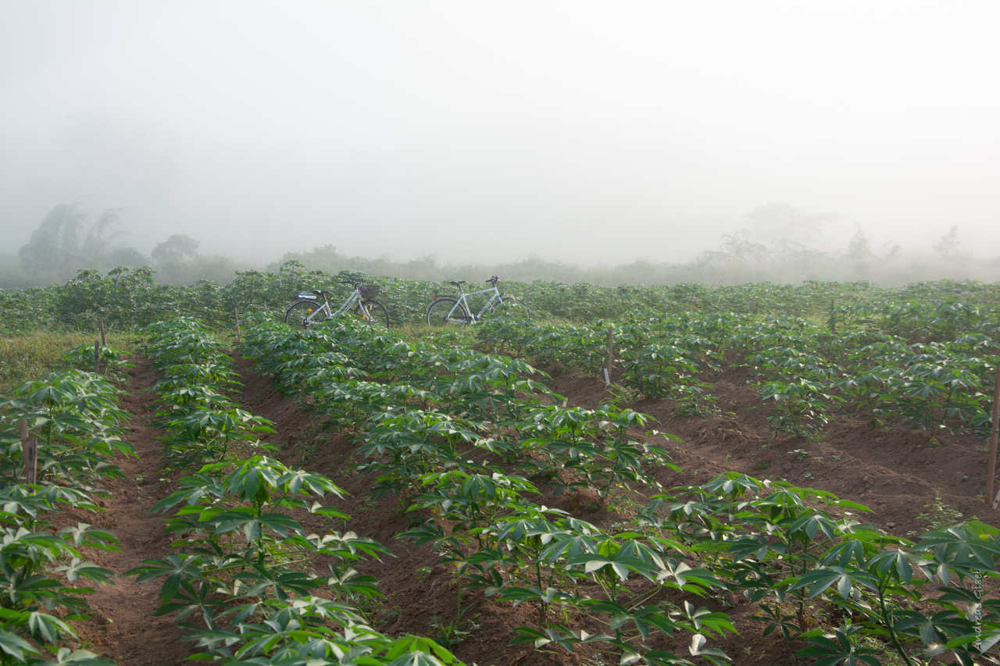

{width=700}

We use the same data on both NGS days. Come back to this page whenever you need to find the files again.

# The samples

The data we will be working on are DNA sequencing data and RNA sequencing data from cassava cultivars.

The paired end DNA sequences were retrieved from the cassava cultivar called [TMEB117](https://www.researchgate.net/publication/376387151_Haplotype-resolved_genome_of_heterozygous_African_cassava_cultivar_TMEB117_Manihot_esculenta), a cultivar whose genome is now known and that, due to its susceptibility to certain cassava diseases, can be used as a reference for studying virus resistance mechanisms in cassava.

The paired end RNA sequencing data comes from a cassava genotype called [TMEB419](https://www.agrobiotech.bio/en/cassava/57-manioc.html). This cultivar was bred to be highly resistant to various cassava viruses and is used commercially.

The reference sequence is chromosome01 from the latest cassava genome build [V8](https://phytozome-next.jgi.doe.gov/info/Mesculenta_v8_1). To save time and computing power we use only this one chromosome.

Special thanks to Andreas Gisel for providing these samples (and the picture above)!

# The files

| File | What it is |
|------|------------|
| `TMEB117_R1_frac.fastq`, `TMEB117_R2_frac.fastq` | DNA sequencing: paired-end reads of cultivar TMEB117 (a fraction of the full run) |
| `TMEB419RNA_frag_R1.fastq`, `TMEB419RNA_frag_R2.fastq` | RNA sequencing: paired-end reads of cultivar TMEB419 (a fragment of the full run) |
| `chromosome01.fasta` | Reference sequence: chromosome 1 of the cassava genome V8 |
| `Mesculenta_671_v8.1.gene_exons.gff3` | Gene annotation for the reference, in GFF3 format |
| `Mesculenta_671_v8.1.gene_exons.gtf` | The same annotation in GTF format, which STAR needs |

# Data location

The data is on the server in the course directory, in the folder `teachers/course_data/NGS/`. You find the course directory in Canvas.

Save the path in a variable, so you only have to type it once (replace `<course directory>` with the path from Canvas):

```{.bash}
DATA=<course directory>/teachers/course_data/NGS
ls -lh $DATA
```

::: {.callout-note}
A variable only lives as long as your terminal session. If you log in again, or start a new screen session, set `DATA` again.
:::

# Your working directory

Over the two days you build up this folder structure in your own folder in the course directory:

```
NGS_course/
├── raw/                  links to the fastq files (day 1)
├── singularity_images/   container images
├── scripts/              your SLURM scripts
├── fastqc/               FastQC reports (day 1)
├── multiqc/              MultiQC report (day 1)
├── fastp/                trimmed reads (day 1)
└── mapping/              (day 2)
    ├── ref/              links to the reference, and the indexes
    ├── bowtie2/          DNA mapping results
    └── star/             RNA mapping results
```
