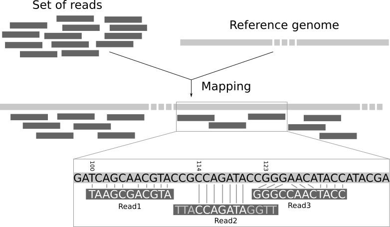
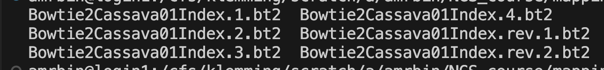
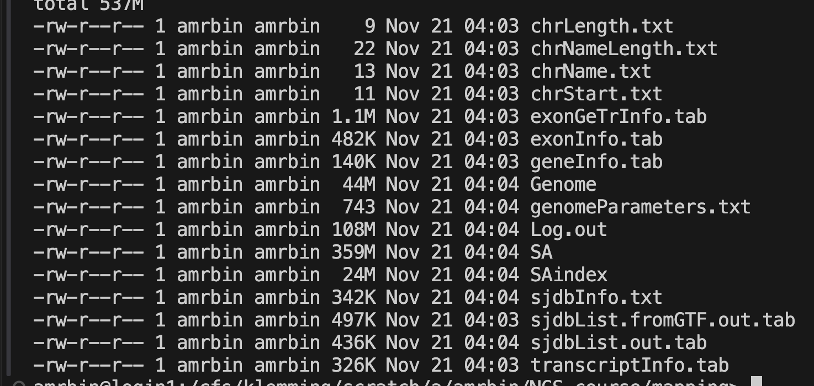

# Introduction to NGS Mapping

Now that you have looked at the quality of the samples, we will go to the next step of a typical analysis: mapping the reads to a reference genome. Once we know where our reads map we can continue to annotate our reads. You will annotate a genome in a different module of this course. 


# Learning objectives

- map NGS sequences to a reference
- use different tools for different types of data
- train the command line more and more independently
- navigate absolute and relative paths when using the command line
- structure your project directories to be well organized

# Preparations

## Connect to HPC2N

For this tutorial we will connect to the course server.

To connect to the server, please follow the instructions [here](../server_access.qmd).

Quick access link to the on-demand service of HPC2N: 

[HPC2N on-demand link](https://portal.hpc2n.umu.se/public/landing_page.html).

## Navigate to your course directory

Make sure you are in your folder in the course directory. If you need a reminder of the folder layout from the first NGS day, see [The NGS data](NGS_data.qmd).

::: {.callout-note collapse="true"}
## Skipped NGS day 1? Unfold here to set up what you need

The mapping exercises build on the folder layout from day 1. If you don't have an `NGS_course` folder yet, create it now (replace `<course directory>` with the path from Canvas):

```{.bash}
cd <course directory>
mkdir -p <your_name>/NGS_course/raw
cd <your_name>/NGS_course
mkdir scripts singularity_images
ln -s <course directory>/teachers/course_data/NGS/*.fastq raw/
ls raw
```

`ls raw` should list four fastq files. Then go back to `<course directory>/<your_name>` and carry on below.

You won't have the trimmed reads in `fastp/`. That's fine, because today we map the raw reads. For how containers and `sbatch` work, see [Quality control](qc_exercises.qmd).
:::

## Start a screen session

[Screen](https://www.gnu.org/software/screen/manual/screen.html) or GNU Screen is a terminal multiplexer. In other words, it means that you can start a screen session and then open any number of windows (virtual terminals) inside that session. Processes running in Screen will continue to run when their window is not visible even if you get disconnected.


Start a `named session`

```{.bash}
screen -S mapping
```
You can detach from the screen session. The process within the screen will continue to run.

```{.bash}
Ctrl + a d
```

You can always reattach to the session. If you have a number of screen running, or are unsure of the name or ID of the screen you want to reattach to you can list the currently running screens:

```{.bash}
screen -ls
```

To `resume your screen session` use the following command:

```{.bash}
screen -r name
```

::: {.callout-important}
## To do for you
Can you find the screen session that you started on the first NGS day?
:::


# Read mapping

When studying an organism with a reference genome, it is possible to infer which transcripts are expressed by mapping the reads to the reference genome (**genome mapping**) or transcriptome (**transcriptome mapping**). Mapping reads to the genome requires no knowledge of the set of transcribed regions or the way in which exons are spliced together. This approach allows the discovery of new, unannotated transcripts. ^[[ https://www.ebi.ac.uk/training/online/courses/functional-genomics-ii-common-technologies-and-data-analysis-methods/rna-sequencing/performing-a-rna-seq-experiment/data-analysis/read-mapping-or-alignment/ ]( https://www.ebi.ac.uk/training/online/courses/functional-genomics-ii-common-technologies-and-data-analysis-methods/rna-sequencing/performing-a-rna-seq-experiment/data-analysis/read-mapping-or-alignment/ )]

Read mapping is the process to align the reads on a reference genome. A mapper takes as input a reference genome and a set of reads. Its aim is to align each read in the set of reads on the reference genome, allowing mismatches, indels and clipping of some short fragments on the two ends of the reads.  

Below is an illustration of the mapping process. The input consists of a set of reads and a reference genome. In the middle, it gives the results of mapping: the locations of the reads on the reference genome. The first read is aligned at position 100 and the alignment has two mismatches. The second read is aligned at position 114. It is a local alignment with clippings on the left and right. The third read is aligned at position 123. It consists of a 2-base insertion and a 1-base deletion  ^[[https://training.galaxyproject.org/training-material/topics/sequence-analysis/tutorials/mapping/tutorial.html ](https://training.galaxyproject.org/training-material/topics/sequence-analysis/tutorials/mapping/tutorial.html )]. 

<br><br>



# Data

In this tutorial we will map data of two experiments against a reference sequence.

The first data set is a paired end DNA sequence of a cassava genotype called TMEB117 and the second data set is a paired end RNA sequencing from a cassava genotype called TMEB419. You have worked with these samples in the last exercise. 

And again a special shoutout to Andreas Gisel for providing these samples!

The reference sequence is chromosome01 from the latest cassava genome built [V8](https://phytozome-next.jgi.doe.gov/info/Mesculenta_v8_1).

## Create a directory to work in

Start by creating a workspace for this exercise in your folder in the course directory, and then move into it:

```{.bash}
mkdir -p  NGS_course/mapping/ref
cd NGS_course/mapping/ref
```

## Symbolic links to data

To save time and computation power we will use only chromosome01 for the exercise.

The reference data files are located in the course directory, in `teachers/course_data/NGS/` (see [The NGS data](NGS_data.qmd)). Save the path in a variable again (replace `<course directory>` with the path from Canvas):

```{.bash}
DATA=<course directory>/teachers/course_data/NGS
```

Create symbolic links to the reference files in your workspace:

```{.bash}
ln -s $DATA/chromosome01.fasta .
ln -s $DATA/Mesculenta_671_v8.1.gene_exons.gff3 .
ln -s $DATA/Mesculenta_671_v8.1.gene_exons.gtf .
```

::: {.callout-important}
## To do for you

Do you remember why we decided to link to the files instead of copying them?
:::


Check that you can now see the linked files in the directory and move back into the directory "mapping".

```{.bash}
ls
cd ..
```

# Mapping DNA sequences

## Bowtie 2

Now we are all set to map our paired end DNA sequences onto the reference.

[Bowtie2](https://bowtie-bio.sourceforge.net/bowtie2/index.shtml) is an ultrafast and memory-efficient tool for aligning sequencing reads to long reference sequences. It is particularly good at aligning reads of about 50 up to 100s or 1,000s of characters, and particularly good at aligning to relatively long (e.g. mammalian) genomes. Bowtie 2 indexes the genome with an FM Index to keep its memory footprint small: for the human genome, its memory footprint is typically around 3.2 GB. Bowtie 2 supports gapped, local, and paired-end alignment modes.

## Apptainer image

Go to [seqera containers](https://seqera.io/containers/), and get the container image path for `bioconda::bowtie2`. Remember to get the singularity container, not the one for docker. 

Pull the image into the singularity_images directory. 

::: {.callout-caution collapse="true"}
## Expand to see the code - try yourself first
```{.bash}
apptainer pull --name bowtie2_2.5.5.sif oras://community.wave.seqera.io/library/bowtie2:2.5.5--8fdad5cac15e31bc
```
:::

## Create index

Each NGS mapper uses indices to accelerate the mapping process, but unfortunately each one has his own way to create these indices. Therefore we first need to create the index for `bowtie2` of our reference sequence, which we will call Bowtie2Cassava01Index and will be located in the reference directory. 

Create a bash file within the scripts directory:

```{.bash}
touch bowtie_index.sh
```

And copy the following into the file: 

```{.bash}
#! /bin/bash -l

#SBATCH -A <course project ID>
#SBATCH -t 05:00
#SBATCH -n 1

set -ueo pipefail

# Define input reference and output directory
REFERENCE=mapping/ref/chromosome01.fasta
OUTPUT_DIR=mapping/ref/

apptainer exec singularity_images/bowtie2_2.5.5.sif \
    bowtie2-build -o 3 $REFERENCE $OUTPUT_DIR/Bowtie2Cassava01Index
    
echo "complete"
```

Save the above code and run the script using

```{.bash}
sbatch scripts/bowtie_index.sh
```

::: {.callout-important}
From where are you calling this script?
:::

You will get the following index files:




## Map with bowtie2

Now that we have the index we create a directory for the bowtie2 results:

```{.bash}
mkdir mapping/bowtie2
```

and then we can run the mapping: 

Make a file in the scripts folder `bowtie2_mapping.sh`.

```{.bash}
#! /bin/bash -l

#SBATCH -A <course project ID>
#SBATCH -t 15:00
#SBATCH -n 4

set -ueo pipefail

# Get CPUS allocated to slurm script (-n above)
CPUS=$SLURM_NPROCS

INDEX=mapping/ref/Bowtie2Cassava01Index
R1=raw/TMEB117_R1_frac.fastq
R2=raw/TMEB117_R2_frac.fastq

# trimmed data 
# R1=fastp/TMEB117_fastp-trimmed_R1.fastq
# R2=fastp/TMEB117_fastp-trimmed_R2.fastq

apptainer exec singularity_images/bowtie2_2.5.5.sif \
    bowtie2 --very-sensitive-local \
    --threads $CPUS \
    -x $INDEX \
    -S mapping/bowtie2/TMEB117.sam \
    -1 $R1 \
    -2 $R2 |& tee mapping/bowtie2/TMEB117.log

echo "complete"
```

::: {.callout-important}
## To do for you
Save the script in the scripts directory and run the code. 
:::

::: {.callout-tip}
You can check running jobs with

```{.bash}
squeue -u <your_user_name>
```
:::

We will get a mapping file in the SAM format and the log file with the mapping statistics.

> mapping/bowtie2/TMEB117.sam\
> mapping/bowtie2/TMEB117.log

::: {.callout-important}
## To do for you

Check the log: how many read pairs mapped concordantly to exactly one place in the reference? What does “concordantly” mean, and why might a pair map to more than one place?
:::

Check the SAM file and check how many hits we have - use `samtools` to do so.

::: {.callout-important}
## To do for you
Get the appropriate container and use it from within with `apptainer shell`. Look into the `samtools manual` to figure out how to look at the file.
:::

Now you can play around a bit. You could see what influence the trimming might have on the mapping of these data. For that re-run the mapping with the trimmed data. Make sure you point towards the correct file paths!

Check the log and SAM file and see what difference we have.

Time allowing, I propose to run a third test mapping either using the raw data of trimmed data by changing the mapping mode from local to end-to-end or from very-sensitive to fast, loosing some accuracy but reducing the mapping time.

Replace in the commands above *--very-sensitive-local* to *--very-sensitive*   or from *--very-sensitive-local* to *--fast-local*.

Again, compare the output with the previous ones.

# Mapping RNA seq data

The data set `TMEB117` is `DNA` sequencing data and `bowtie2` the right tool for mapping and data analysis.

`TMEB419` however is `RNA` sequencing data. While we could map the data with bowtie2 (try it out if you want to), there are aligners that are dedicated for RNA sequencing data. These find splicing sites within the reads and guarantee an accurate reconstruction of the sequenced transcripts.

## STAR

[STAR](https://github.com/alexdobin/STAR) is one such splicing site sensitive mapper for RNA sequencing data.

## Apptainer image 


Go to [seqera containers](https://seqera.io/containers/), and get the container image path for `bioconda::star`. 

Pull the image into the same directory as the other container images.

::: {.callout-note}

Which one was that again?
:::

::: {.callout-caution collapse="true"}
## Expand to see the code for the pull - try yourself first
```{.bash}
apptainer pull --name star_2.7.11b.sif oras://community.wave.seqera.io/library/star:2.7.11b--d61915af03bd3432
```
:::

## Prepare index

The data we will use for this part of the tutorial is paired end `RNA sequencing data` and is already in your `/raw` directory (`TMEB419RNA_frag_R1.fastq, TMEB419RNA_frag_R2.fastq`).

First, we need to generate the STAR index, and this time we will include gene annotations to enable the mapped reads to be associated with known genes and transcripts.

Next we have to create the directory where we will store the STAR index for chromosome 1. Let's use the `/ref`directory for that:

```{.bash}
mkdir mapping/ref/STARCassava01Index
```

The indexing script for STAR will be the following:

:::{.callout-tip}
## Exercise

Do you remember all the steps you need to do to run the script?
:::

::: {.callout-caution collapse="true"}
## Expand to see how to run it - try yourself first
Save the below in the scripts directory:

```{.bash}
touch scripts/star_index.sh
```

and run it from the mapping directory with

```{.bash}
sbatch scripts/star_index.sh
```
:::


```{.bash}
#! /bin/bash -l

#SBATCH -A <course project ID>
#SBATCH -t 05:00
#SBATCH -n 1

set -ueo pipefail

INDEX=mapping/ref/STARCassava01Index
REFERENCE=mapping/ref/chromosome01.fasta
GTF=mapping/ref/Mesculenta_671_v8.1.gene_exons.gtf

apptainer exec singularity_images/star_2.7.11b.sif \
    STAR    --runMode genomeGenerate \
        --genomeDir $INDEX \
        --genomeFastaFiles $REFERENCE \
        --sjdbGTFfile $GTF \
        --genomeSAindexNbases 11 \
        --genomeChrBinNbits 16 \
        --outTmpDir mapping/star_tmp
```

With this you will end up with a bunch of index files:



Files like `geneInfo.tab`, `exonGeTrInfo.tab`, `transcriptInfo.tab`, `exonInfo.tab`, `sjdbList.fromGTF.out.tab`, `sjdbList.out.tab`, `sjdbInfo.txt` contain the indexing information of the predicted genes, transcripts, exons and splicing sites annotated in the `Mesculenta_671_v8.1.gene_exons.gtf file`. Have a look around!

::: {.callout-important}
## To do for you

Have a look around the files to see what you discover!
:::

## Map with STAR

Now we are ready to map the RNA sequences to the reference sequence.

Make a directory for the output:

```{.bash}
mkdir mapping/star
```

And then save the following script and run it with sbatch (like above). 


```{.bash}
#! /bin/bash -l

#SBATCH -A <course project ID>
#SBATCH -t 15:00
#SBATCH -n 4

set -ueo pipefail

# Get CPUS allocated to slurm script (-n above)
CPUS=$SLURM_NPROCS

INDEX=mapping/ref/STARCassava01Index
READ1=raw/TMEB419RNA_frag_R1.fastq
READ2=raw/TMEB419RNA_frag_R2.fastq

apptainer exec singularity_images/star_2.7.11b.sif \
    STAR --genomeDir $INDEX \
        --runThreadN $CPUS \
        --outFilterMismatchNoverLmax 0.06 \
        --outFilterMatchNminOverLread 0.5 \
        --outFilterScoreMinOverLread 0.2 \
        --alignIntronMax 20000 \
        --alignMatesGapMax 10000 \
        --outFileNamePrefix mapping/star/TMEB419RNA_  \
        --readFilesIn $READ1 $READ2

echo "complete"
```

Run with `sbatch`. 

Your output will be the SAM file, report files and the list of predicted splicing sites.


::: {.callout-important}
## To do for you

Inspect the report file and check the mapped reads and the average mapped length.

Is this a good mapping?
:::

# Next steps

After quality control and mapping, a typical next step when working with NGS data would be to annotate the reads, so you get an idea of what you are looking at. You will do that later in this course. 

::: {.callout-important}
## To do for you

Look back at the NGS_course directory. What do you think, did you manage to keep the chaos at bay? What went well in keeping order and what could be improved? Discuss with your neighbour.
:::

For now, please do not forget to take the lab quiz for today in Canvas. Then you are done for the day. \(o:

