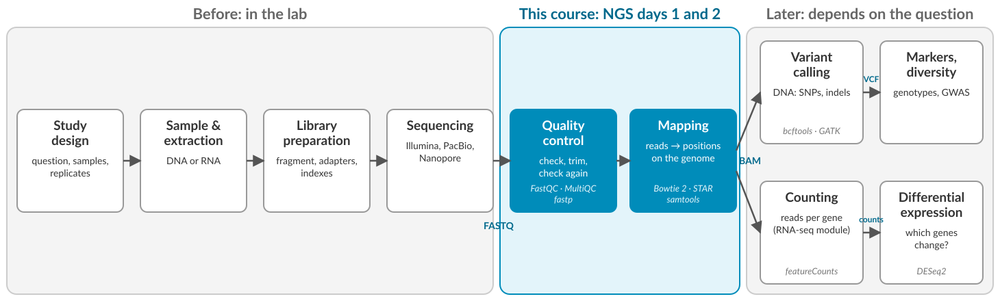
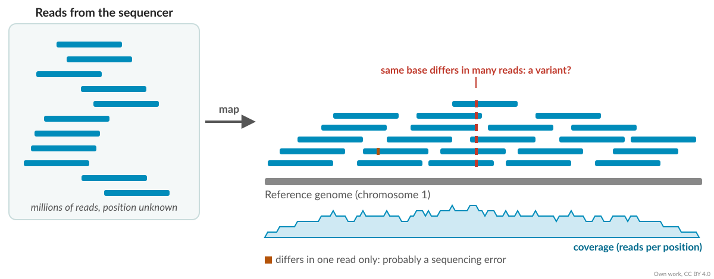
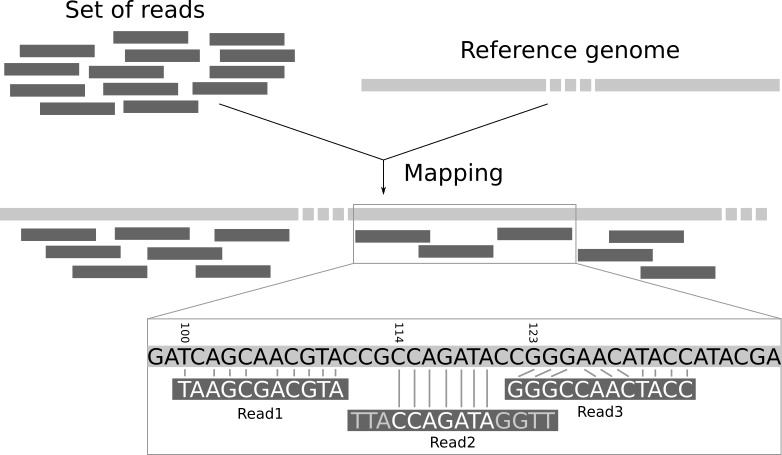
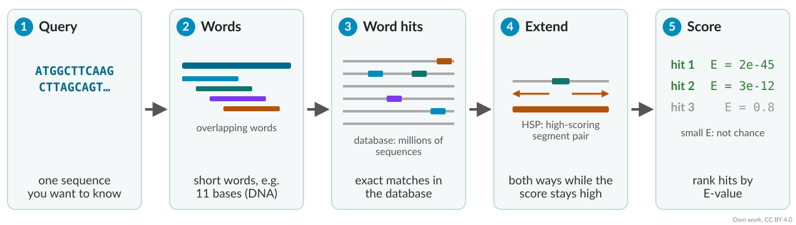
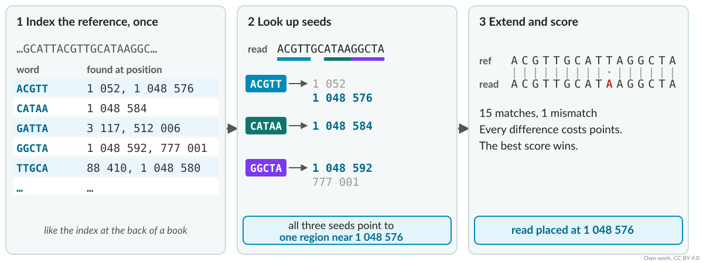
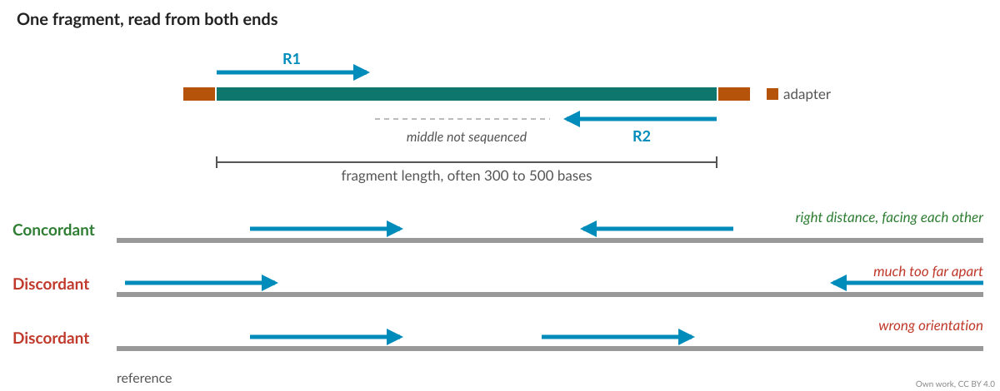
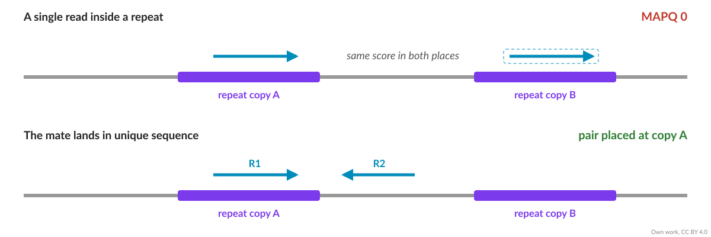
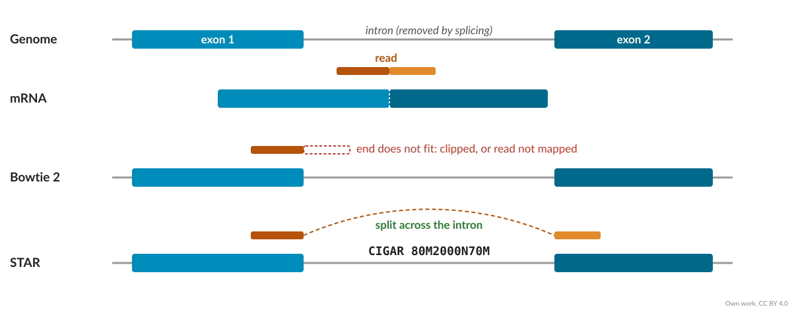
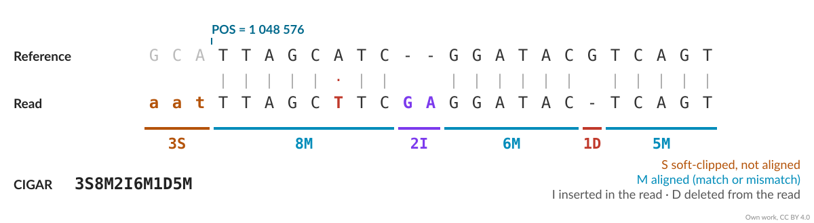

## This lecture

1. Mapping and BLAST: what they do, and how they differ
2. Alignments: mismatches, gaps, pairs and repeats
3. RNA: reads across splice junctions
4. SAM files and mapping statistics
5. The exercises

## Where we are in the workflow




# What is mapping?

## From reads to positions

[]{style="display:block; height:1.5em"}

After sequencing we have millions of short reads, and we don't know where any of them came from.

**Mapping** finds, for each read, the place in a **reference** where it fits best.

- **Reference genome:** the assembled chromosomes of the species
- **Reference transcriptome:** the sequences of all known transcripts

. . .

Once reads have a position we can count them per gene, look for variants, or check coverage.

## Many reads, one reference

[]{style="display:block; height:1.5em"}

{fig-align="center"}


## Mapping in a picture

[]{style="display:block; height:1.5em"}

{fig-align="center" width="80%"}

::: {.small}
Read 1: two mismatches. Read 2: local alignment, both ends clipped. Read 3: a 2-base insertion and a 1-base deletion.
Figure: [Galaxy Training Network](https://training.galaxyproject.org/training-material/topics/sequence-analysis/tutorials/mapping/tutorial.html)
:::

# BLAST: searching for similar sequences

## BLAST

**B**asic **L**ocal **A**lignment **S**earch **T**ool (Altschul et al., 1990)

- One sequence, the **query**, against a large **database** (for example NCBI nt, or all proteins)
- Finds **similar** sequences, not only identical ones, also in other species
- Answers: *what is this sequence?*

. . .

[]{style="display:block; height:1.5em"}

| Program | Query | Database |
|---------|-------|----------|
| blastn | DNA | DNA |
| blastp | protein | protein |
| blastx | DNA, translated | protein |
| tblastn | protein | DNA, translated |


## How BLAST works

{fig-align="center"}

**Seed and extend**: look for short exact matches first, then align only around them.


## Reading a BLAST hit

[]{style="display:block; height:1.5em"}

| Column | Meaning |
|--------|---------|
| % identity | Share of identical positions in the alignment |
| Alignment length | How much of the query is aligned |
| Bit score | Alignment score, independent of the database size |
| **E-value** | Number of hits this good expected **by chance** in a database this size |

. . .

[]{style="display:block; height:1.5em"}

::: {.callout-tip appearance="simple" icon="false"}
**E-value:** close to 0 (e.g. 1e-50) means the hit is very unlikely to be chance. Around 1 or above means it could easily be chance.
:::


## BLAST or a mapper?

[]{style="display:block; height:1.5em"}

| | BLAST | Read mapper (Bowtie 2, STAR) |
|-|-------|------------------------------|
| Question | What is this sequence? | Where in **this** genome does it come from? |
| Queries | One or a few | Millions of reads |
| Database | Many species | One reference genome |
| Differences allowed | Many: finds distant relatives | Few: same or closely related species |
| Speed per sequence | Seconds | Microseconds |

. . .

[]{style="display:block; height:1.5em"}

Both **seed and extend**. Mappers make it fast by indexing one reference **once**, and by expecting the read to be almost identical to it.


# Finding the place fast

## Why not just search?

[]{style="display:block; height:1.5em"}

- 20 million read pairs × a genome of roughly 700 Mb (cassava)
- Comparing every read with every position: about 10^16^ comparisons
- Searching with BLAST would take weeks

. . .

Mappers first build an **index** of the reference, once. Then each read is looked up in the index, like a word in the index at the back of a book.

## Index, seed, extend

[]{style="display:block; height:1.5em"}

{fig-align="center"}

[]{style="display:block; height:1.5em"}

Each mapper builds its **own** index format. A Bowtie 2 index cannot be used by STAR.


# Alignments

## What an alignment allows

[]{style="display:block; height:1.5em"}

| Difference | Why it happens |
|-----------|----------------|
| Mismatch | Sequencing error, or a real variant (SNP) |
| Insertion / deletion | Sequencing error (homopolymers), or a real indel |
| Soft clipping | Adapter left on the read, low-quality ends, structural variant |

[]{style="display:block; height:1.5em"}

Every difference costs points. The mapper reports the alignment with the best score.

## End-to-end or local?

[]{style="display:block; height:1.5em"}

**End-to-end:** the whole read must align. Unaligned ends are penalised as mismatches.

**Local:** the ends may be **clipped** if they don't fit. Good when reads still carry adapter or low-quality ends.

. . .

[]{style="display:block; height:1.5em"}

In Bowtie 2: `--very-sensitive` (end-to-end) vs `--very-sensitive-local` (local). You will try both.

## Paired-end reads

{fig-align="center" height="440"}

A pair that maps as expected is **concordant** (Bowtie 2) or **properly paired** (samtools).


## Reads that fit in many places

Genomes are full of repeats: transposons, gene families, duplicated regions.

{fig-align="center" height="300"}

::: {.small}
- A read that fits equally well in several places is a **multi-mapping** read. The mapper picks one at random, or reports all of them.
- **MAPQ** (mapping quality) says how sure the mapper is: 0 means it could be anywhere.
:::


## Plant genomes are special

[]{style="display:block; height:1.5em"}

- Large and full of **transposable elements**: often more than half the genome
- Often **polyploid**: several copies of each chromosome, similar but not identical
- Often **heterozygous**: cassava is, so the two copies of a chromosome differ

. . .

Your cultivar is not the reference cultivar. Differences between them will look like mismatches to the mapper.

# RNA

## Reads across exons

[]{style="display:block; height:1.5em"}

In RNA-seq, reads come from **spliced** transcripts. Many reads span an exon-exon junction.

{fig-align="center" height="430"}


## Splice-aware mappers

[]{style="display:block; height:1.5em"}

- **STAR**, **HISAT2**: allow a read to be split across an intron
- An annotation (**GTF**) tells them where known exons and junctions are
- They also find **new** junctions from the data

. . .

That is why STAR needs the `.gtf` file when it builds its index, and Bowtie 2 doesn't.

## Which mapper for which data?

[]{style="display:block; height:1.5em"}

| Data | Typical tools |
|------|---------------|
| DNA, short reads | Bowtie 2, BWA-MEM2 |
| RNA, short reads | STAR, HISAT2 |
| Long reads (DNA or RNA) | minimap2 |
| RNA, counts only | Salmon, kallisto (pseudo-alignment, no exact positions) |

# The SAM format

## SAM: one line per alignment

[]{style="display:block; height:1.5em"}

A header (lines starting with `@`), then 11 tab-separated columns per read:

| Column | Name | Example |
|--------|------|---------|
| 1 | Read name | `read_123` |
| 2 | FLAG | `99` |
| 3 | Reference | `Chromosome01` |
| 4 | Position | `1048576` |
| 5 | MAPQ | `42` |
| 6 | CIGAR | `5S70M` |
| 7 to 9 | Mate: reference, position, fragment length | `=`, `1048790`, `289` |
| 10, 11 | Sequence, qualities | `ACGT…`, `FFF:…` |

## CIGAR: read alignment

[]{style="display:block; height:1.5em"}

{fig-align="center"}

In RNA-seq you will also see `N`: a skipped region, the intron (e.g. `80M2000N70M`).


## FLAG: yes/no answers in one number

[]{style="display:block; height:1.5em"}

FLAG is a sum. Each yes/no answer has its own value:

| Value | Meaning | In FLAG 99? |
|------:|---------|:-----------:|
| 1 | Read is paired | yes |
| 2 | Pair is properly paired | yes |
| 4 | Read is unmapped | |
| 16 | Read is on the reverse strand | |
| 32 | Mate is on the reverse strand | yes |
| 64 | First read of the pair (R1) | yes |
| 128 | Second read of the pair (R2) | |
| 256 | Not the primary alignment | |

[]{style="display:block; height:1.5em"}

99 = 1 + 2 + 32 + 64. Decode any FLAG at [broadinstitute.github.io/picard/explain-flags.html](https://broadinstitute.github.io/picard/explain-flags.html).

## SAM, BAM and samtools

[]{style="display:block; height:1.5em"}

- **SAM** is text: readable, but large
- **BAM** is the compressed binary version of the same data
- **samtools** converts, sorts, indexes and summarises them

```bash
samtools view -b sample.sam > sample.bam
samtools sort -o sample.sorted.bam sample.bam
samtools index sample.sorted.bam
samtools flagstat sample.sorted.bam
```

# Mapping statistics

## What does a good mapping look like?

[]{style="display:block; height:1.5em"}

| | DNA, same species | RNA-seq |
|-|-------------------|---------|
| Overall alignment rate | above 90 % | 70 to 90 % uniquely mapped |
| Properly paired | most pairs | most pairs |
| Multi-mapping | a few % | a few % to 10 % |

These are rules of thumb for a **whole** reference genome.

## Unmapped reads

[]{style="display:block; height:1.5em"}

- Wrong or incomplete reference
- Contamination (bacteria, fungi, human)
- Adapters or poor quality left on the reads
- A divergent cultivar or species
- rRNA in RNA-seq

. . .

::: {.callout-important}
In the exercise we map to **chromosome 1 only**. Cassava has 18 chromosomes. What mapping rate do you expect?
:::

# The exercises

## You will

[]{style="display:block; height:1.5em"}

| Sample | Data | Mapper | Index needs |
|--------|------|--------|-------------|
| TMEB117 | DNA, paired-end | Bowtie 2 | chromosome01.fasta |
| TMEB419 | RNA, paired-end | STAR | chromosome01.fasta + .gtf |

[]{style="display:block; height:1.5em"}

- Build both indexes, map, read the logs
- Compare raw and trimmed reads, local and end-to-end
- Look inside the SAM file with samtools

## Summary

[]{style="display:block; height:1.5em"}

- Mapping places each read on a reference, using an index to be fast
- BLAST finds similar sequences across species; mappers place millions of reads in one genome
- Alignments allow mismatches, gaps and clipping, each at a cost
- Pairs and MAPQ help with repeats; plant genomes have many
- RNA needs a splice-aware mapper such as STAR
- SAM/BAM stores the result; the log tells you if it worked
