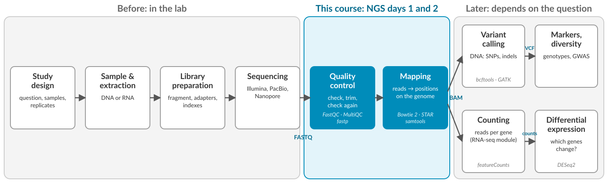

Next-generation sequencing (NGS) turns DNA or RNA from a sample into millions of short text strings, the so called reads. Reads contain the called bases, but on their own tell you very little. Before they can answer a biological question, we need to check that they are trustworthy (are of good enough quality), and work out where in the genome each one comes from. This is the basis of many different workflows, regardless of what data you will work with. So that is what we will concentrate on in this module.

{fig-alt="Workflow from study design, sample and extraction, library preparation and sequencing, through quality control and mapping, to variant calling or counting reads per gene."}

## The data before it reaches us

Before any NGS data hits a terminal, it's journey typically begins in the minds of the researchers, and then goes to the lab: 

- **Study design:** what is the question the experiment should answer? which samples are necessary? how many replicates should be included?
- **Sample extraction:** Samples are taken, and DNA or RNA is extracted. Its purity and integrity limit everything that follows.
- **Library preparation:** the DNA or RNA is fragmented, adapters and sample indexes are added so the sequencer can process the samples.
- **Sequencing:** the sequencer reads the fragments and writes the results to so called FASTQ files: they contain the sequence of each read, as well as a quality score for every base of the sequence.

Often, you will get FASTQ files from a sequencing facility without having seen any of the steps above. However, each of them can leave traces in the data, and can influence the answers you will get from the data. This is why quality control is so importan: it can tell you much about your data, and the answers you can get from them.

## Day 1: Quality control

**What we do:** We will check the quality of the raw cassava reads with FastQC, collect the reports with MultiQC, trim the reads with fastp, and check them again.

**Why is it important?** Bad input gives bad results, and you need to know your data to assess if you can trust its results. Your analyses will run whether the input data is good or bad, it is up to you to interpret them. Low-quality bases can look like mutations, leftover adapters stop reads from mapping, and a contaminated sample can look like a biological difference. Quality control tells you whether the data can be used as it is, needs cleaning, or should not be used at all.

## Day 2: Mapping

**What we do:** We will map our quality controlled reads to the cassava reference genome using specialized programs: DNA reads will be mapped with Bowtie 2, and RNA-seq reads with STAR. This results in a BAM file, which we can inspect with samtools.

**Why is it important?** A read is only useful once you know where in the genome it belongs. Mapping places each read on the reference genome. With this information we can run many more analyses: getting information on the gene function, finding variants, counting reads per gene, or measuring coverage.

## The data after we are done with it

In other modules of this course you will encounter some analyses that come after the quality control and mapping: you will encounter genome annotation (what do we know about the locations we mapped the reads to?), RNAseq analyses (what genes are expressed in our samples?), and metagenomics (how can we deal with mixed species samples, and what information can we get out of them?).

## How will we work?

We will run our analyses on a high performance computing cluster, called HPC2N, using what you learned on the Bash and HPC day:

- the tools run in **containers** with Apptainer, so you don't install anything yourself
- longer jobs go to the queue with **SLURM**
- the data stays in one shared place, and you link to it from your own folder

[The NGS data](NGS_data.qmd) explains the data and the folder layout. Each day follows the same pattern: a recorded lecture and a lecture quiz before class, a discussion in class, exercises, and a lab quiz in Canvas.

- [Day 1: Quality control](day1.qmd)
- [Day 2: Mapping](day2.qmd)
