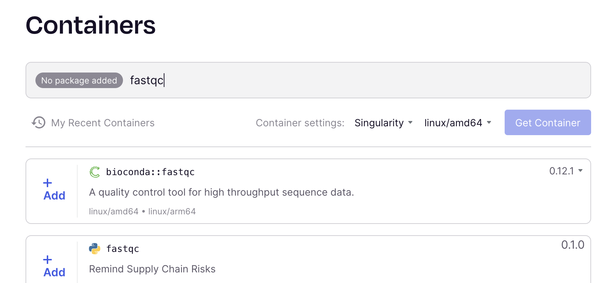
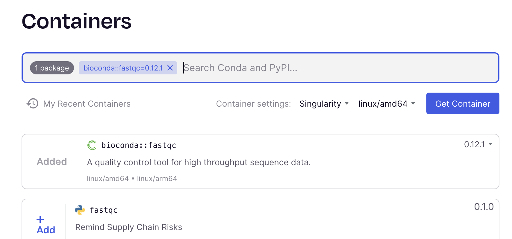
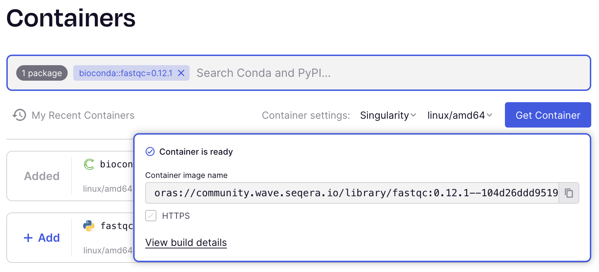

<br>
Regardless of what type of bioinformatics project you are working on, you will have to assess whether the data you have is of good enough quality to proceed with - bad input data can seriously impair your ability to draw conclusions from the samples later on!

Poor quality sequencing data can be caused by a variety of factors, such as sample contamination, improper sample handling, technical problems. Some of these problems will be checked for before and during the sequencing - it is always good to read all documentation coming from the sequencing facility. 

When it comes to sequencing data, FastQC is a well known and often used software to check raw reads for their quality. 

::: {.callout-note}
Sample preparation includes fragmenting the genome into the **sequencing library**.

A **read** is the inferred nucleotide base sequence of a genome fragment as determined by the sequencer. 
:::


# Quality Control Tutorial

Within this tutorial we will

- use the job scheduler `slurm`
- learn about containers, and where to get them, and how to use them with `apptainer`
- run `fastqc` on some raw sequencing files to practice and to understand the output
- run `multiqc` to summarize the FastQC output
- run `fastp` to do adapter trimming

# The reasoning behind the tutorial

You will run the three tools on the data today. The first time the instructions are detailed and you can mostly copy-paste the commands. However, for the next tool you will have to develop your own commands, based on the ones from the first tool. 

So, what I am trying to tell you: try to understand what you are doing the first time around already, it will greatly help you the second and third time around. (o:


# Preparations

## Connect to HPC2N

For this tutorial we will connect to the course server.

To connect to the server, please follow the instructions [here](../server_access.qmd).

Quick access link to the on-demand service of HPC2N: 

[HPC2N on-demand link](https://portal.hpc2n.umu.se/public/landing_page.html).

## Create your own folder

Go to the course directory (you find its path in Canvas), create a folder with your name, and move into it:

```{.bash}
cd <course directory>
mkdir <your_name>
cd <your_name>
```

Replace `<your_name>` with your own name, without spaces, for example `anna_svensson`.

::: {.callout-important}
Do all of today's work inside this folder, and come back to it on day 2. If you log out, start again with `cd <course directory>/<your_name>`.
:::

::: {.callout-tip}
Use the command line commands `ls` to list the contents of the directory you are currently in, `pwd` to print the path of the current working directory, and `cd` to navigate between directories. 
:::

## Start a screen session

[Screen](https://www.gnu.org/software/screen/manual/screen.html) or GNU Screen is a terminal multiplexer. In other words, it means that you can start a screen session and then open any number of windows (virtual terminals) inside that session. Processes running in Screen will continue to run when their window is not visible even if you get disconnected.


Start a `named session`, with the name `qc`:

```{.bash}
screen -S qc
```
You can detach from the screen session. The process within the screen will continue to run.

```{.bash}
Ctrl + a d
```

You can always reattach to the session. If you have a number of screen running, or are unsure of the name or ID of the screen you want to reattach to you can list the currently running screens:

```{.bash}
screen -ls
```

To `resume your screen session` use the following command:

```{.bash}
screen -r name
```

## Create a directory to work in

From within your folder `<course directory>/<your_name>`, start by creating a workspace for the raw data used in this exercise, and then move into it:

```{.bash}
mkdir -p  NGS_course/raw
cd NGS_course/raw
```

## Create symbolic link to the data

The raw data files are located in the course directory, in `teachers/course_data/NGS/` (see [The NGS data](NGS_data.qmd)). Save the path in a variable (replace `<course directory>` with the path from Canvas):

```{.bash}
DATA=<course directory>/teachers/course_data/NGS
ls $DATA
```

You could copy the files into your workspace to access them. However, it is better to create symbolic links (also called soft links) to the data files. This saves disk space and still allows you to work with them as if they were in your own directory.

Create symbolic links to the fastq files in your workspace:

```{.bash}
ln -s $DATA/*.fastq .
```

You now have four files in your directory: two for the TMEB117 cultivar containing the DNA sequences, and two for the TMEB419 cultivar, containing the RNA sequencing results.

::: {.callout-important}
## To do for you
Leave the `/raw` directory and make sure that you are back in `<your_name>/NGS_course`.
:::


# Data format

You now have the raw sequencing data, in a very common data format, fastq. Let's have a look at the data (change the name of the file accordingly): 

```{.bash}
head -n 8 raw/TMEB117_R1_frac.fastq
```

For each read we see an entry consisting of four lines. Every new read starts with an `@`. 

| Line | Content|
|-|-----|
| 1    | Information about the read, always starts with an `@`|
| 2    | nucleic sequence of the read|
| 3    | starts with \`+\`, can (but does not have to) contain data|
| 4    | characters representing the quality scores with the bases of the read sequence |

: Fastq format

::: {.callout-note}
The quality score is encoded in ASCII, to represent scores from 0 (high probability of error in calling the base) to 42 (low probability of error in calling the base). 
:::

We could now look through the fastq file and scan the quality scores for the reads in our sample one by one. Sounds kind of tedious, doesn't it? Luckily, here comes FastQC (and other, similar tools). 


# FastQC Intro

[`Fastqc`](https://www.bioinformatics.babraham.ac.uk/projects/fastqc/) is a simple tool to monitor the quality and the properties of a NGS sequencing file in fastq, SAM and BAM format.

FastQC will give us an overview of the entire sample, so we won't have to look at the quality score of every single read in the sample. 

In addition to the quality scores, FastQC also performs a series of quality control analyses, called modules. The output is a HTML report with one section for each module, and a summary evaluation of the results in the top. "Normal" results are marked with a green tick, slightly abnormal results raise warnings (orange exclamation mark), and very unusual results raise failures (red cross).

Keep in mind that even though FastQC is giving out pass/fail results for your samples, these evaluations must be taken in the context of what you expect from your library. A ‘normal’ sample as far as FastQC is concerned is random and diverse. However, because of project design your samples might deviate from this expectation. The summary evaluations should be pointers to where you have to concentrate your attention and understand why your library may not look random and diverse.

::: {.callout-important}
## To do for you
Let's see which version is installed on the server:

```{.bash}
fastqc --version
```
:::

Oh no! FastQC is not installed on the server, what can we do? 

# Containers

In this tutorial, we will be using `containers` to run tools and specific tool versions that may not be directly installed on the system we are working on.

## What are containers?

Containers are stand-alone pieces of software that require a container management tool to run. They are build and exchanged as container images that specify the contents of the container, such as the operating system, all dependencies, and software in an isolated environment. The container management tool then takes the images and build the container. These management tools can be run on all operating systems, and since the container has the operating system within it, it will run the same in all environments. Container images are easily portable and immutable, so they are stable over time.

## Running Containers

There are several programs that can be used to build and run containers. [Docker](https://www.docker.com), [Apptainer](https://apptainer.org), and [Podman](https://podman.io) are the most commonly used platforms to date. They all have their pros and cons. If you are using a Windows machine that only you are using, then Docker is likely the least complex tool to install. On multi-user systems like a server, Apptainer is the best tool for the job. For this tutorial and the rest of the course, we will use Apptainer commands. 

## Getting apptainer image

One good place to get quality controlled Apptainer/Singularity containers that contain the tools we want to use is [seqera containers](https://seqera.io/containers/).

- Open their homepage in a new tab.

- In the searchbar, type in the tool you want - fastqc



<br><br>

- Add the tool you want to have in your container (in this case `fastqc` from Bioconda). Be aware, the screenshot in this material might show a different tool version than the one you will see. 

- In the container settings underneath the search bar, select Singularity and linux/amd64

- Click "get container".



<br><br>

- Once the container is ready copy the path of the image.




## Download container images

To have a nice and clean project directory we will make a new sub-directory that will contain all the singularity images we will use during this tutorial.

```{.bash}
mkdir singularity_images
cd singularity_images
```

Now we can pull the container image from its location into our folder:

```{.bash}
apptainer pull --name fastqc_0.13.0.sif oras://community.wave.seqera.io/library/fastqc:0.13.0--918df8ee88833f73
```

In this command we tell apptainer, the container system software, to pull a container with a name we can set ourselves, from a source `oras...`.


Then we move out of the directory again:

```{.bash}
cd .. 
```


### Running Containers
Once you have pulled the container image, you want to be able to use it. Apptainer can be used to build the container from the image.

#### running "from the outside"

There are 2 different ways to use a container: `run` and `exec`. The `apptainer run` command launches the container and first runs the `%runscript` for the container if one is defined, and then runs your command (we will cover `%runscript` in the `Building Containers` section). The `apptainer exec` command will not run the `%runscript` even if one is defined. It is a small, fiddly detail that might be applicable if you use other people's containers. After calling Apptainer and the `run` or `exec` commands, you can use your software as you usually would

```{.bash}
apptainer exec singularity_images/fastqc_0.13.0.sif fastqc --version
```

This command runs your `fastqc_0.13.0.sif` container from the image, calls on the program `fastqc` that is within the container, and shows you the version. If you had installed FastQC locally, you would have just used 

```{.bash}
fastqc --version
```

::: {.callout-important}
FastQC is just an example. If you want to run any other tool everything after `apptainer run` or `apptainer exec` has to be substituted by the name of the specific container image and the run commands for that particular tool!
:::


#### running interactively "from the inside"

You can also enter the container, and work interactively from within. For that you use the `apptainer shell` command:

```{.bash}
apptainer shell singularity_images/fastqc_0.13.0.sif
```

Inside the container, your prompt will change to `Singularity` (remember, that is the legacy name for Apptainer). Now you can use the tools inside the container. 

To exit the container, simply type and enter `exit`. 

Great, now we have FastQC ready and can use it. How can we submit the job to the server?

## SLURM

HPC2N is running SLURM (Simple Linux Utility for Resource Management) as its job scheduling system. When you submit a job on the cluster log-in node, SLURM will start, execute and monitor your jobs on the working nodes. It allocates access to the cluster resources, and manages the queue of pending jobs. [Here](https://docs.hpc2n.umu.se/documentation/batchsystem/intro/) is a more thorough documentation of SLURM on Kebnekaise. 

To be able to do so, SLURM needs a bit of information from us when we submit a job:

- -A: project_ID (to deduct the used computing time from the correct project) 
- -t allocated time dd-hh:mm:ss (to optimize the job queue) 
- -n number of cores (default is one)

## Running fastqc with sbatch

We will now write a script that runs fastqc on our samples - using the container we pulled. We will add the slurm flags from above and then submit to the server queue with the SLURM command `sbatch`. 

Again, we want to maintain a clean and orderly project directory:

In your NGS_course folder, create a directory for the FastQC output and a new directory called scripts. Within the scripts directory create a file called fastqc.sh.

```{.bash}
mkdir fastqc
mkdir scripts
cd scripts
touch fastqc.sh
```

::: {.callout-tip}
## Touch
Touch makes a new file with the given name. You can then open it in the file explorer (left side of VS-Code). 
:::

Copy the following into the file, and save the contents. Read through the file and try to understand what the different lines are doing.

```{.bash}
#! /bin/bash -l
# The name of the compute account you are running in, mandatory.
#SBATCH -A <course project ID>
# Request runtime for the job (HHH:MM:SS) where 168 hours is the maximum. Here asking for 15 min. 
#SBATCH -t 15:00
# Request resources - here for four cpus
#SBATCH -n 4

# FastQC needs the output folder to exist
mkdir -p fastqc

apptainer exec singularity_images/fastqc_0.13.0.sif \
    fastqc -t 4 --outdir fastqc/ raw/*.fastq
echo "complete"
```

The slurm options used here:

- A: project ID (you find it in Canvas)
- t allocated time dd-hh:mm:ss
- n number of cpus

FastQC's `-t 4` tells it to use the four cpus we asked for.

Move back into the NGS_course directory and submit the script to slurm:

```{.bash}
cd ..
sbatch scripts/fastqc.sh
```

After running a bash script you will get a slurm output. Look at that output. See if you understand what that output contains.

```{.bash}
less slurm-XXXXX.out
```

Locate the output of FastQC.

::: {.callout-note}
Which output directory did you specify in the batch file?
:::


For each fastq file you will get two output files:

> TMEB117_R1_frac_fastq.zip (report, data files and graphs) 

> TMEB117_R1_frac_fastq.html (report in html)

::: {.callout-important}
## To do for you
Now you can download the .html report from the server and look at them: 

In VScode: right click on the file in the file explorer --> download

From another terminal: open a local different terminal and navigate to where you want the files on your computer. Then copy the files with rsync (modify as needed). 

```{.bash}
rsync -ah <user_name>@kebnekaise.hpc2n.umu.se:<course directory>/<your_name>/NGS_course/fastqc .
```

- What is the quality of your sample? 
- Look at online resources to see if what you see is a problem, or expected because of the type of data you work with. A nice resource here is for example the [FastQC tutorial from the Michigan State University](https://rtsf.natsci.msu.edu/genomics/technical-documents/fastqc-tutorial-and-faq.aspx).
:::

You see that it is getting kind of tedious to look through all the different files one by one. Okay with only a few files, but imagine having to sift through a few dozen, or even hundreds of reports.

# MultiQC

[MultiQC](https://seqera.io/multiqc/) searches a given directory for analysis logs and compiles a HTML report. It's a general use tool, perfect for summarising the output from numerous bioinformatics tools. It aggregates results from bioinformatics analyses across many samples into a single report.

### Pull the apptainer image

On the seqera container page choose `bioconda::multiqc` for your container image. Proceed to pull the container image, following the steps we did for `fastqc`. Name the image after the version you get, for example `multiqc_1.32.sif`, and use the same name in the script below.

### Download container image

Download the container image with `apptainer pull`. The `--name` flag lets you re-name the image to a more intuitive name. 

::: {.callout-note}
Good practice is to name it after the tool and its version number.
:::

Copy the image into your singularity_images folder, if it isn't there yet.


### Running multiqc with sbatch

Within your scripts directory, make a new file, multiqc.sh, and add the following:

```{.bash}
#! /bin/bash -l

#SBATCH -A <course project ID>
#SBATCH -t 15:00
#SBATCH -n 1

apptainer exec singularity_images/multiqc_<version>.sif \
    multiqc -f -o multiqc .
```

Navigate out of the scripts directory back into the NGS_course directory. 

Run the bash script with

```{.bash}
sbatch scripts/multiqc.sh 
```

The command output (in the slurm.out file) looks something like:


>  /// MultiQC 🔍 v1.32
> 
> file_search | Search path: <course directory>/<your_name>/NGS_course/fastqc
> 
> fastqc | Found 4 reports
> 
> write_results | Data        : multiqc/multiqc_data   (overwritten)
> write_results | Report      : multiqc/multiqc_report.html   (overwritten)
> multiqc | MultiQC complete


Download the report and look at it. 

::: {.callout-important}
## To do for you

Understand what is going on. Read the documentation.

Do we need to adapter trim any samples?
:::

# FastP

[FastP](https://github.com/OpenGene/fastp) is a FASTQ data pre-processing tool. The algorithm has functions for quality control, trimming of adapters, filtering by quality, and read pruning.

Dependent on what analysis you need to do with the NGS data it is wise to process the data according to the quality control and remove low score sequences and/or low score 5' and 3' fragments. It makes sense to trim adapters for downstream analyses, but quality filtering can remove information that modern downstream tools can still utilize.

Let's get the output into a different directory:

```{.bash}
mkdir fastp
```

Find and retreive the container image from seqera containers.

Make sure the image is in the `singularity_images` folder with the other images. Move it if necessary. 

Save the following script as `scripts/fastp.sh` and submit it from your NGS_course folder with `sbatch scripts/fastp.sh`:

```{.bash}
#! /bin/bash -l

#SBATCH -A <course project ID>     # Project allocation
#SBATCH -t 15:00             # Time limit
#SBATCH -n 4                 # Number of cores

# Get CPUs allocated to the script
CPUS=$SLURM_NPROCS

# Define input files
DATA_DIR=raw/
OUT_DIR=fastp/
FILES=( $DATA_DIR/*_R1*.fastq )

# Function to run fastp
apply_fastp() {
    READ1="$1"      # Read 1 of the pair
    READ2="$2"      # Read 2 of the pair

    # Ensure READ1 and READ2 are distinct
    if [ "$READ1" == "$READ2" ]; then
        >&2 echo "Error: READ1 and READ2 are the same file. Check string substitution."
        exit 1
    fi

    # Extract prefix from READ1
    PREFIX=$(basename "${READ1%_R1*}")

    # Run fastp within the Singularity container
    apptainer exec singularity_images/<the name you gave the image>.sif \
        fastp -w $CPUS \
        -i "$READ1" \
        -I "$READ2" \
        -o "${OUT_DIR}${PREFIX}_fastp-trimmed_R1.fastq" \
        -O "${OUT_DIR}${PREFIX}_fastp-trimmed_R2.fastq" \
        --json "${OUT_DIR}${PREFIX}_fastp.json" \
        --html "${OUT_DIR}${PREFIX}_fastp.html"

    echo "Processed ${PREFIX}"
}

# Main script execution
# Process files as pairs
for ((i = 0; i < ${#FILES[@]}; i+=1)); do 
    FASTQ="${FILES[i]}"
    apply_fastp "$FASTQ" "${FASTQ/_R1/_R2}"
done

echo "complete"
```

::: {.callout-important}
## To do for you

Do you understand the bash script? Discuss with your neighbour and check out the manual for fastp.
:::

Run the script. 


::: {.callout-important}
## To do for you

Once you get the cleaned sequences run multiqc again to check the result.
:::

When you are done, take the lab quiz for today in Canvas.


# Troubleshooting

## Where am I?

Most "file not found" errors come from running a command in the wrong folder. Run `pwd` to print the folder you are in, `ls` to list what is in it, and `cd` to move.

| Step | Run it in |
|------|-----------|
| Link the data | `<your_name>/NGS_course/raw` |
| Pull container images | `<your_name>/NGS_course/singularity_images` |
| Write scripts | `<your_name>/NGS_course/scripts` |
| Submit jobs with `sbatch` | `<your_name>/NGS_course` |

The paths in the scripts are relative to `NGS_course`, so jobs have to be submitted from there. After logging in again, start with `cd <course directory>/<your_name>/NGS_course`.

## Common errors

The messages may look slightly different from the ones here.

| Message | What it means |
|---------|---------------|
| `command not found: apptainer` | You are in a terminal on your own computer, not on Kebnekaise. Log in first. |
| `FATAL: could not open image` | The image name in the script doesn't match the file in `singularity_images`. Compare with `ls singularity_images`. |
| `unrecognized arguments: -o` (FastQC) | Newer FastQC versions only accept `--outdir`. |
| FastQC: output directory does not exist | Create it first with `mkdir -p fastqc`. |
| `No analysis results found` (MultiQC) | The FastQC job wasn't finished, or the job was submitted from the wrong folder. Check with `squeue -u $USER` and `ls fastqc`. |
| `Invalid account` | Check the project ID after `#SBATCH -A`. You find it in Canvas. |

## Is my job running?

- `squeue -u $USER` lists your jobs that are waiting or running. A finished job disappears from the list.
- `sbatch` prints a job ID. The job's output and errors are in `slurm-<job ID>.out`, in the folder you submitted from. Read it with `cat slurm-<job ID>.out`.

When you are done, take the lab quiz for today in Canvas.

