## This lecture

After this lecture you can:

1. Explain why QC of sequencing data is necessary
2. Interpret FastQC reports and their warnings
3. Decide what action, if any, to take based on QC results

## Where we are in the workflow

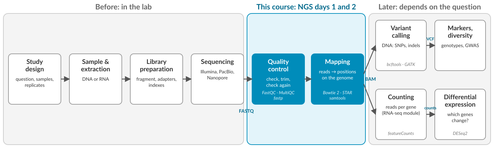


# Why quality control?

## From plant to reads

> Plant tissue → DNA extraction → Library preparation → Sequencing → FASTQ files

Each step can introduce technical effects that later show up in QC reports.

. . .

We sequence to answer a **biological question**: which variants, which alleles, which genes are expressed.

All of these assume that **the sequencing data reflects the real biology of the plant.** QC checks whether that assumption is reasonable.

## What can go wrong?

| Technical issue | | Biological consequence |
|-----------------|:-:|------------------------|
| Low base quality | → | False SNPs |
| Adapter contamination | → | Artificial variants |
| GC bias | → | Skewed allele frequencies |
| High duplication | → | Overconfidence in genotypes |
: {.big-table}

. . .

::: {.callout-note appearance="simple" icon="false"}
**In a breeding context** this could mean choosing the wrong markers, missing true marker-trait associations, misjudging genetic diversity.
:::

## Step 1: DNA extraction

:::: {.columns}
::: {.column width="55%"}
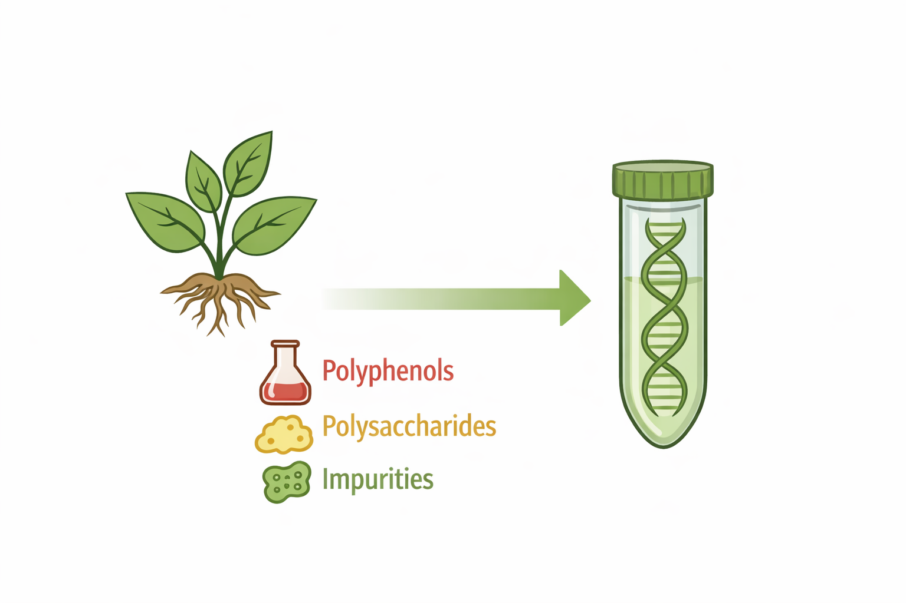
:::
::: {.column width="45%"}
- Polyphenols and polysaccharides interfere with enzymes and make DNA sticky
- DNA quality varies between samples, tissues, methods and people
:::
::::

## Step 2: Library preparation

:::: {.columns}
::: {.column width="55%"}
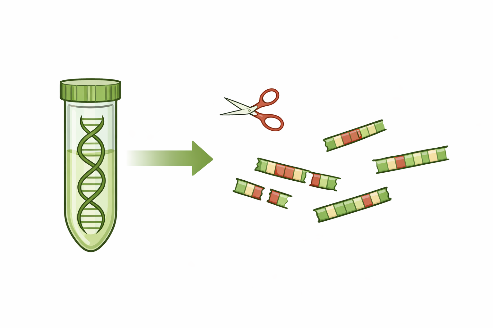
:::
::: {.column width="45%"}
- DNA is sheared, adapters are ligated, fragments are amplified by PCR
- Degraded DNA gives **uneven coverage**
- PCR amplifies some fragments more than others: **PCR bias**
:::
::::

## Step 3: Sequencing

:::: {.columns}
::: {.column width="55%"}
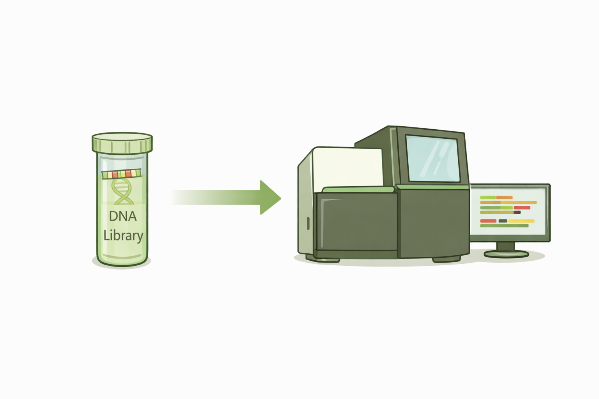
:::
::: {.column width="45%"}
- Base calls get less accurate towards the end of the read
- Errors accumulate over cycles
- Lanes and runs differ in quality
:::
::::

## Plant genomes are special

QC tools are **generic**. They don't know your data comes from a plant.

- Large genomes, high repeat content
- Polyploidy and high heterozygosity
- GC content that varies between species

. . .

So GC plots can look unusual and duplication can be high, even for good data.

**QC tools show you *what* looks unusual. You need biological knowledge to decide *why*.**

## The raw reads

From the sequencer we get the raw data in FASTQ file format. Each read takes four lines:

[]{style="display:block; height:1.5em"}

::: {.big}
```
@A00123:45:HKLMNDSX3:2:1101:10004:1000 1:N:0:ACGTACGT
GATCCTAGCAATGGTCGTACCGTTAGCTTGAACCTAGGATCAGTTCAAGC
+
FFFFFFFFF:FFFFFFFFFFF:FFF,FFFFFFF:FFFF:FF,F:F:,#:,
```
:::

[]{style="display:block; height:1.5em"}

| Line | Content |
|------|---------|
| 1 | `@` + read name: instrument, run, flow cell, lane, tile, position; `1` = read 1 of the pair |
| 2 | The sequence |
| 3 | `+` (sometimes the name again) |
| 4 | One quality character per base |


## Quality scores

:::: {.columns}
::: {.column width="50%"}
**Phred score**

Q = −10 × log~10~(P~error~)

| Q | Error rate | Accuracy |
|---|-----------|----------|
| 10 | 1 in 10 | 90% |
| 20 | 1 in 100 | 99% |
| 30 | 1 in 1,000 | 99.9% |
| 40 | 1 in 10,000 | 99.99% |
:::
::: {.column width="50%"}
**One character per base**

Q = ASCII code − 33

| Character | ASCII | Q |
|:---------:|:-----:|:-:|
| `#` | 35 | 2 |
| `,` | 44 | 11 |
| `:` | 58 | 25 |
| `F` | 70 | 37 |

:::
::::


# FastQC

## What FastQC does

- Reads a FASTQ file: millions of reads, each with a quality score per base
- Runs a series of standard tests, called modules
- Writes an HTML report with a figure or table per module

. . .

FastQC does not know your experiment or your plans. The interpretation and decisions are up to you.

## Pass, warn, fail

Every module gets a label: ✅ pass, ⚠️ warn, ❌ fail.

- A fail does not mean the data is unusable
- A pass does not mean the data is perfect
- Thresholds are generic: they assume random, whole-genome DNA

. . .

Treat the flags as signals to investigate, not as decisions.

## Basic statistics

:::: {.columns}
::: {.column width="55%"}
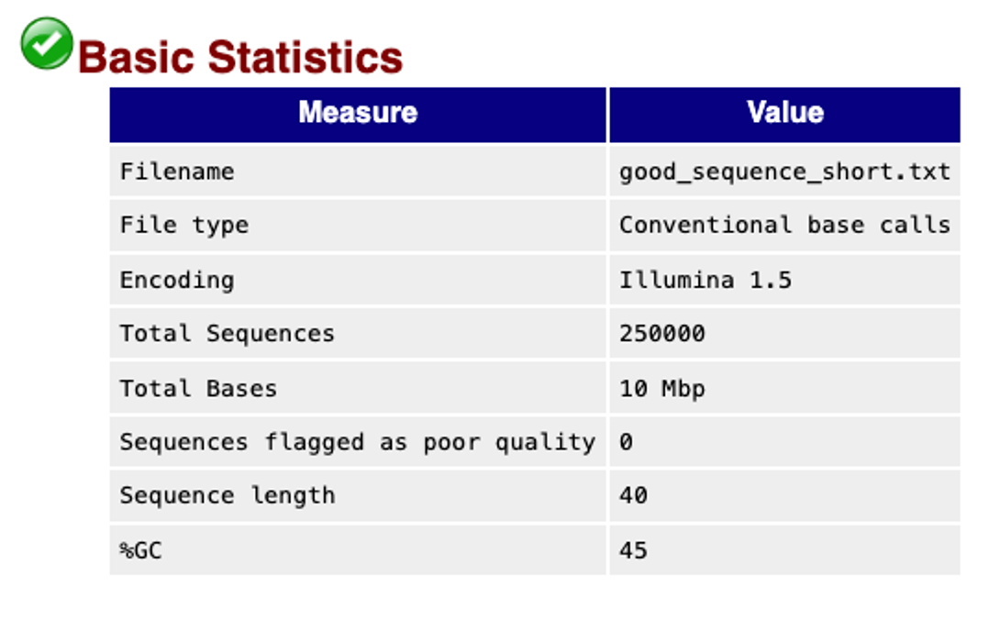
:::
::: {.column width="45%"}
Shows file name, number of reads, read length, GC %.

Check you are looking at the right sample, and compare read numbers between files.

Never raises a warning.
:::
::::

## Per base sequence quality

:::: {.columns}
::: {.column width="55%"}
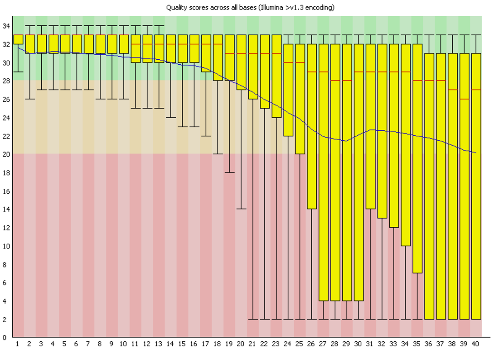
:::
::: {.column width="45%"}
Shows quality scores at each position in the read.

We expect high quality at the start, a slow decline towards the end.

Warning signs include a sharp drop, large parts of the read in the red, big differences between samples.
:::
::::

## Your turn: Pause the video

:::: {.columns}
::: {.column width="55%"}

:::
::: {.column width="45%"}

1. From which position does the quality drop?
2. Would you use these reads as they are?
:::
::::

## The answer

:::: {.columns}
::: {.column width="55%"}

:::
::: {.column width="45%"}
1. The median (red line) stays above 26, but the mean (blue line) drops below 28 around position 19. From position 26 at least a quarter of the reads are in the red zone.
2. Not as they are. **Trim** the low-quality ends, then run FastQC again.
:::
::::

## Per sequence quality scores

:::: {.columns}
::: {.column width="55%"}
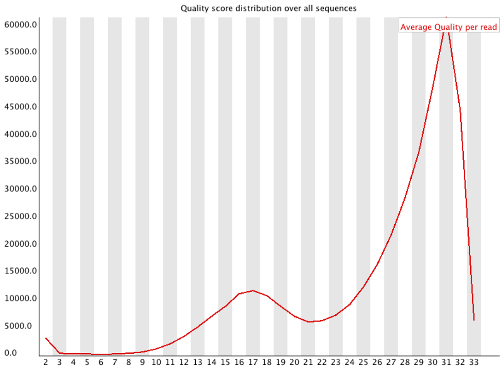
:::
::: {.column width="45%"}
Shows the mean quality **per read**, not per position.

We expect one sharp peak at high quality.

Warning signals include a large share of low-quality reads, or a second peak. Points to library or sequencing problems, or poor starting material.
:::
::::

## Per base sequence content

:::: {.columns}
::: {.column width="55%"}
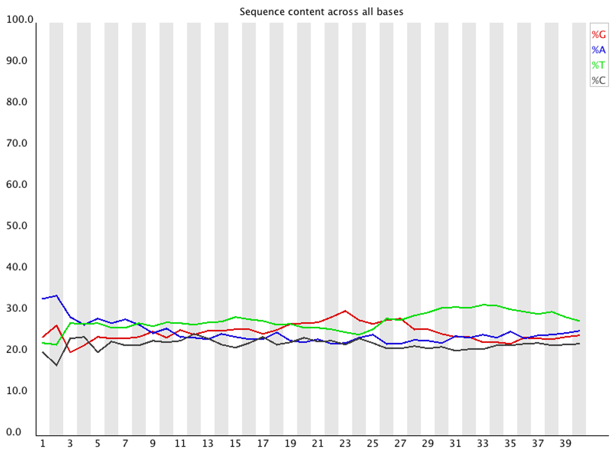
:::
::: {.column width="45%"}
Shows the share of A, C, G and T at each position.

We expect flat lines for random genomic DNA.

But many library types are biased at the start of the read, RNA-seq always. Ask whether the pattern is expected for your experiment.
:::
::::

## Per sequence GC content

:::: {.columns}
::: {.column width="55%"}
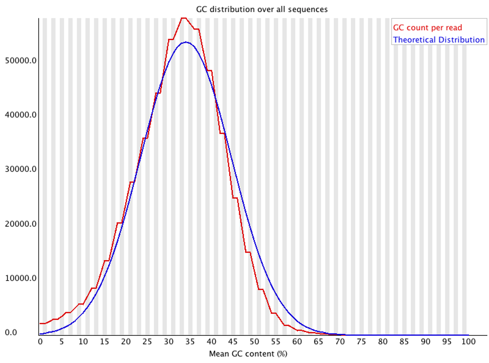
:::
::: {.column width="45%"}
It shows GC content of the reads, against a theoretical curve.

We expect roughly a normal distribution, peaking at the genome's GC content.

Warning signals include a second peak or a shifted sample: contamination. In plants also repeats or genome composition. Always compare samples with each other.
:::
::::

## N content and read length

:::: {.columns}
::: {.column width="50%"}
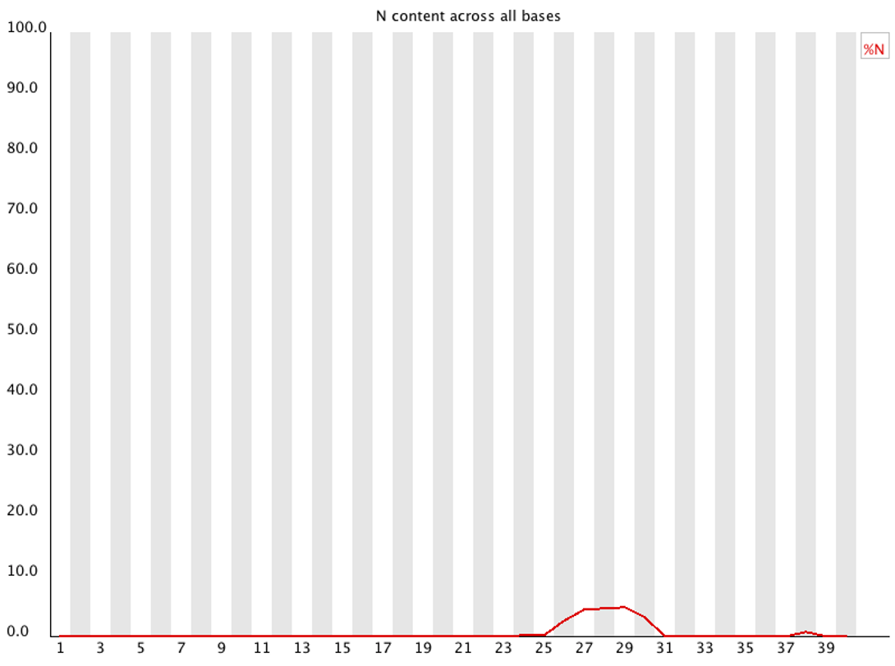
:::
::: {.column width="50%"}
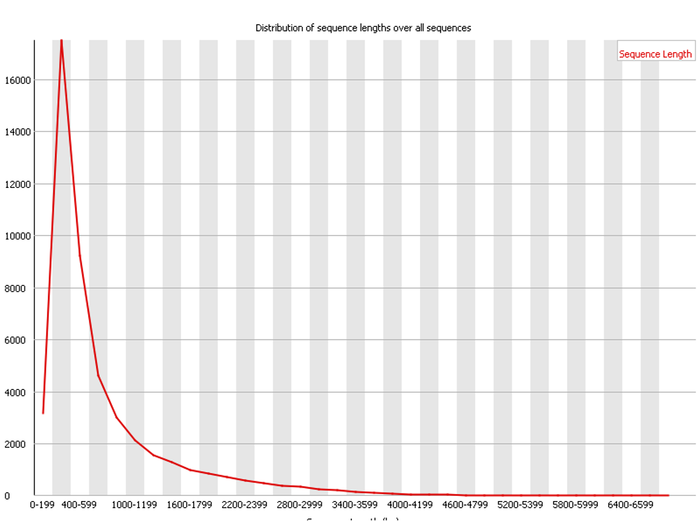
:::
::::

::: {.small}
- N content: the sequencer could not call the base. A few at the end of reads is normal.
- Read lenght: Illumina reads have one length; PacBio and Nanopore vary. After trimming, lengths vary too.
:::

## Sequence duplication levels

:::: {.columns}
::: {.column width="55%"}
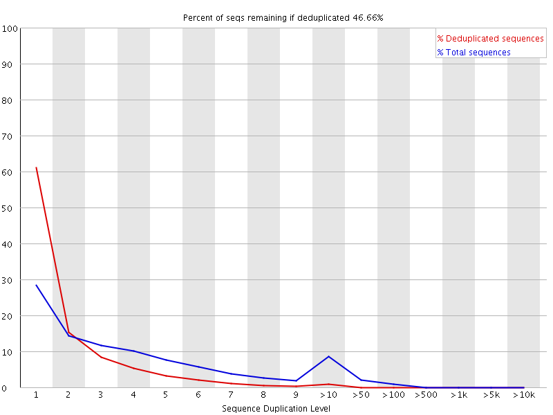
:::
::: {.column width="45%"}
It shows how often identical sequences occur.

We expect most sequences to occur once in a diverse library.

High duplication comes from PCR bias, low library complexity or very deep sequencing. In plants also conserved and repetitive regions. Normal in RNA-seq.
:::
::::

## Overrepresented sequences and adapters

:::: {.columns}
::: {.column width="50%"}
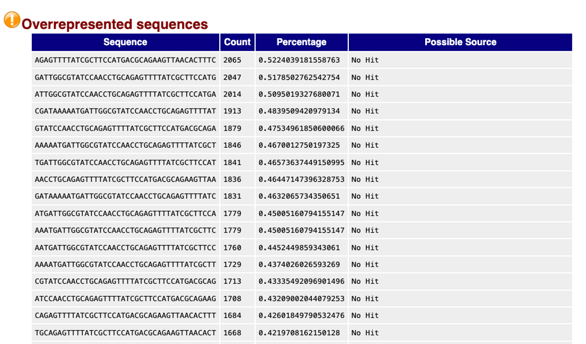
:::
::: {.column width="50%"}
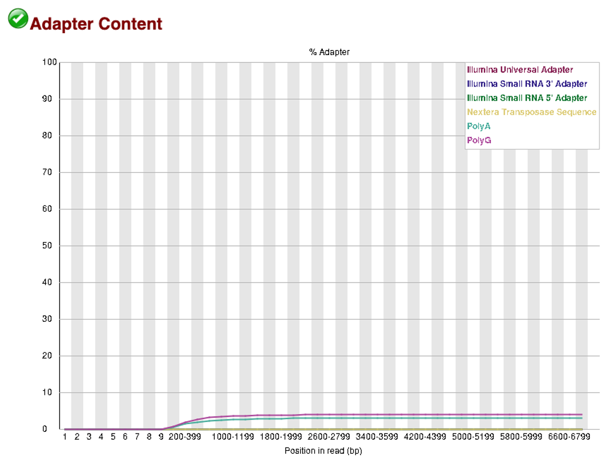
:::
::::

::: {.small}
- Overrepresented means single sequences are much more common than expected. Could be adapters, primers, repeats, or real biology.
- Adapter content shows which adapter is present, and how much. Tells you what to trim.
:::

## K-mer content (optional)

:::: {.columns}
::: {.column width="55%"}
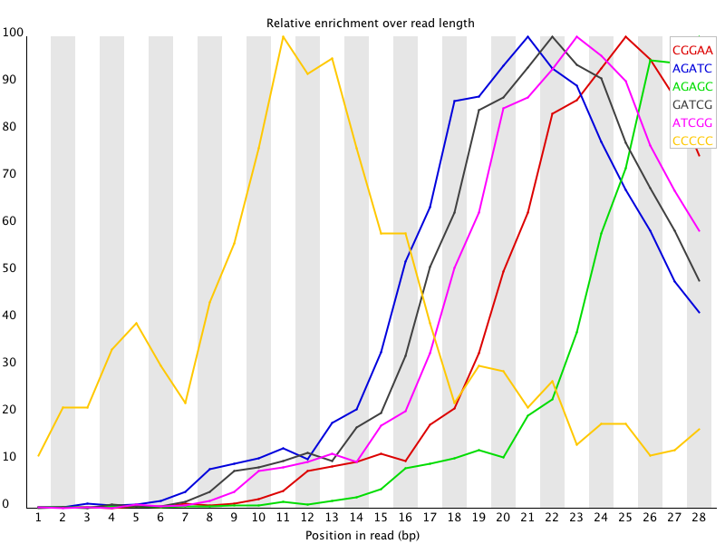
:::
::: {.column width="45%"}
A k-mer is a short sequence of length k, for example the 7-mer `ATCGTGA`.

FastQC looks for k-mers enriched at certain positions. Enrichment at the start or end of reads usually means adapters, primers or library artefacts.

Only 2 % of the reads are checked.
:::
::::

# After QC

## Three possible outcomes

[]{style="display:block; height:1.5em"}

QC helps you to decide what to do next with your data. 

. . .


1. Use as is: minor or expected warnings

. . .

2. Process: trim adapters or low-quality ends, then run FastQC again

. . .

3. Investigate: serious problems may mean re-preparing, resequencing or excluding the sample


## QC in a reproducible workflow

[]{style="display:block; height:1.5em"}

- Run QC the same way on all samples
- Record which issues you saw
- Document what you did about them, and why

## Many samples: MultiQC
[]{style="display:block; height:1.5em"}

Dozens of samples × 2 reads × FastQC before and after trimming: too many reports to read one by one.

[]{style="display:block; height:1.5em"}

**MultiQC** collects them into one report:

- Samples side by side
- Outliers stand out
- Systematic problems across samples become visible

[]{style="display:block; height:1.5em"}

You will use FastQC, MultiQC and fastp in the exercises.

## Summary

- QC protects your biological conclusions from technical problems
- Remeber problems can start long before the FASTQ file: during extraction, library preparation, sequencing
- FastQC flags are signals, not verdicts; interpret them for *your* data and organism
- After QC: use, trim and re-check, or investigate
- Document what you checked and what you did

[]{style="display:block; height:1.5em"}

::: {.small}
FastQC figures and module descriptions adapted from the [FastQC documentation, Babraham Bioinformatics](https://www.bioinformatics.babraham.ac.uk/projects/fastqc/Help/3%20Analysis%20Modules/).
:::
