## Welcome {.center}

High-throughput sequencing: from the molecule to the reads.

::: {.small}
With slides based on presentations of Nicolas Delhomme and Prof. Nathaniel Street
:::

::: {.notes}
Welcome. This lecture covers how DNA and RNA are turned into sequence data: where the technology came from, how libraries are made, how the main short- and long-read platforms work, and what kinds of errors each one makes. That last part leads straight into the quality control lecture and today's exercises.
:::

## Deciphering the blueprint of an organism

- **1977:** Sanger's chain-termination method, one fragment per reaction
- **2001:** first draft human genome (Human Genome Project and Celera). Full project ran 1990–2003: ~13 years, ~\$2.7 billion
- **2022:** first complete human genome (T2T-CHM13, gapless except chrY), made with long reads
- **Today:** a few hundred dollars in reagents and a 1–2 day run

::: {.small}
Lander et al. 2001 Nature 409:860; Venter et al. 2001 Science 291:1304; Nurk et al. 2022 Science 376:44; genome.gov HGP cost fact sheet; Shendure et al. 2017 Nature 550:345
:::

::: {.notes}
DNA sequencing is not new: Sanger published chain termination in 1977. It went big with the Human Genome Project and Celera, whose drafts appeared together in February 2001 on the covers of Nature and Science. The whole public project, from 1990 to 2003, took about 13 years and about 2.7 billion dollars; the 2001 draft alone cost roughly 300 million. The first complete human genome, gapless except for the Y chromosome, only came in 2022 from the Telomere-to-Telomere consortium, using long reads and a haploid cell line. Today the reagents for a human genome cost a few hundred dollars, and the sequencing run takes one to two days.
:::

## This lecture

1. **Sanger sequencing:** the beginning
2. **Library preparation:** DNA and RNA
3. **Short reads:** Illumina and competitors
4. **Long reads:** PacBio and Oxford Nanopore
5. **Choosing a platform:** errors, what's new, NGI

::: {.notes}
Here is the plan. Many of the following slides are adapted from material by Nathaniel Street at Umeå University, updated for 2026. We start with Sanger sequencing, then how DNA and RNA are prepared, then short-read and long-read platforms, and we finish with how to choose a platform and what errors to expect.
:::

## Sanger sequencing: how it started

:::: {.columns}
::: {.column width="40%"}
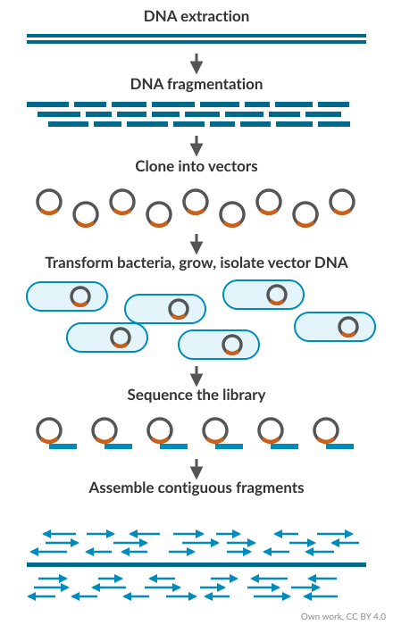{height="560"}
:::
::: {.column width="60%"}
- One reaction per DNA fragment
- Genomes needed clone libraries: lots of lab work, lots of chances for mistakes
- Low throughput: one read (700–1000 bases) per capillary, 96 capillaries per run
- Still used today to check single loci, clones and PCR products
:::
::::

::: {.notes}
In the Sanger era every read needed its own reaction. To sequence a genome, DNA was fragmented, cloned into vectors, grown in bacteria, purified and sequenced clone by clone, then assembled. That is a lot of lab work and a lot of chances to make mistakes. A capillary instrument such as the ABI 3730xl reads 96 samples per run, so throughput was low.
:::

## Chain termination

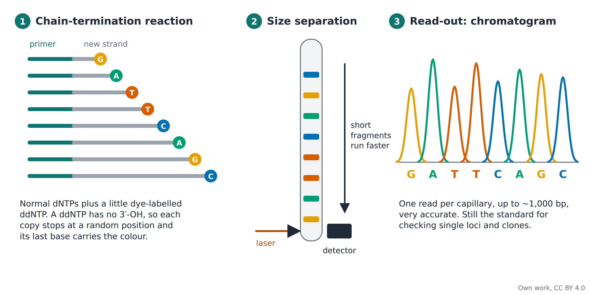

::: {.notes}
The reaction contains normal nucleotides plus a small amount of dye-labelled dideoxynucleotides. A ddNTP has no 3' hydroxyl group, so when the polymerase adds one, the strand stops. Each copy stops at a random position, and its last base carries a colour. Separating the copies by size in a capillary and reading the colours in order gives the sequence.
:::

## Reading a Sanger trace

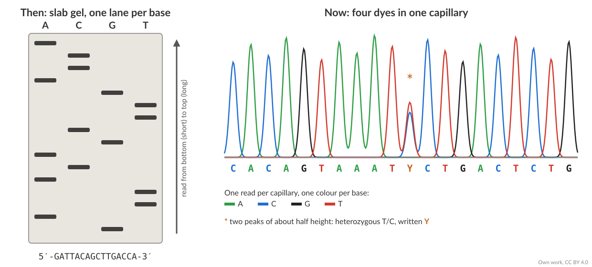

::: {.small}
- **Then:** radioactive slab gels, one lane per base, read by eye
- **Now:** four dyes in one capillary, read by a laser
- Two overlapping peaks of about half height = a heterozygous position
:::

::: {.notes}
Early Sanger sequencing used radioactive slab gels with four lanes, one per base, read by eye from an autoradiograph. Capillary instruments with four dyes replaced them. In a chromatogram, a heterozygous position shows a second peak under the main one. In a clean heterozygote the two peaks are about half height each; uneven peaks need a second look. Sanger still serves as the check for single variants found by NGS.
:::

## "Next" (2nd) generation sequencing

:::: {.columns}
::: {.column width="50%"}
- Sequencing-by-synthesis: massively parallel sequencing
- Millions to billions of fragments sequenced at once
- Illumina still dominates, but there is real competition again: Element AVITI, Ultima UG 100/200, MGI / Complete Genomics DNBSEQ, Roche SBX
- Gone: Roche 454, SOLiD, Helicos. Ion Torrent: clinical niche
:::
::: {.column width="50%"}
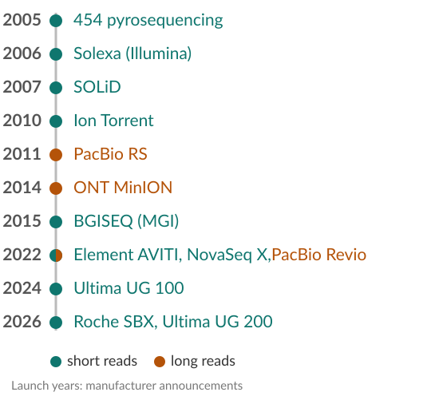
:::
::::

::: {.notes}
Second-generation sequencing reads millions to billions of DNA fragments at the same time, using sequencing by synthesis. For about ten years Illumina dominated short-read sequencing. That is changing: Element Biosciences, Ultima Genomics, MGI and Complete Genomics, and since June 2026 Roche, whose SBX instrument reads an expanded copy of the DNA through a nanopore, are competing. 454, SOLiD and Helicos are gone; Ion Torrent survives in clinical panels. The timeline also shows the long-read platforms, which we cover later.
:::

## The \$1000 genome

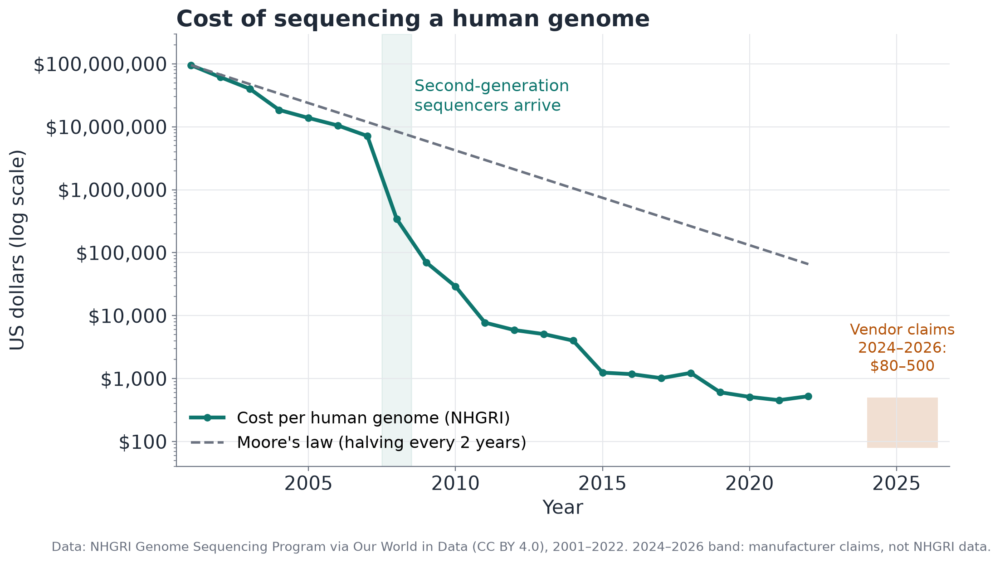{height="480"}

::: {.small}
Data: NHGRI via Our World in Data (CC BY 4.0). 2024–2026: manufacturer claims. Figure: own work, CC BY 4.0
:::

::: {.notes}
This is the NHGRI cost per human genome, on a log scale. Until 2007 cost fell roughly with Moore's law, which NHGRI takes as a halving every two years; the Stephens figure on the next slide uses 18 months. When second-generation instruments arrived around 2008, it dropped far faster. The latest NHGRI data point is from 2022, at about 500 dollars. The shaded box shows what manufacturers claim today, 80 to 500 dollars per genome; these are claims, not independent data, and they leave out labour and analysis.
:::

## Sequencing capacity grows faster than Moore's law

:::: {.columns}
::: {.column width="60%"}
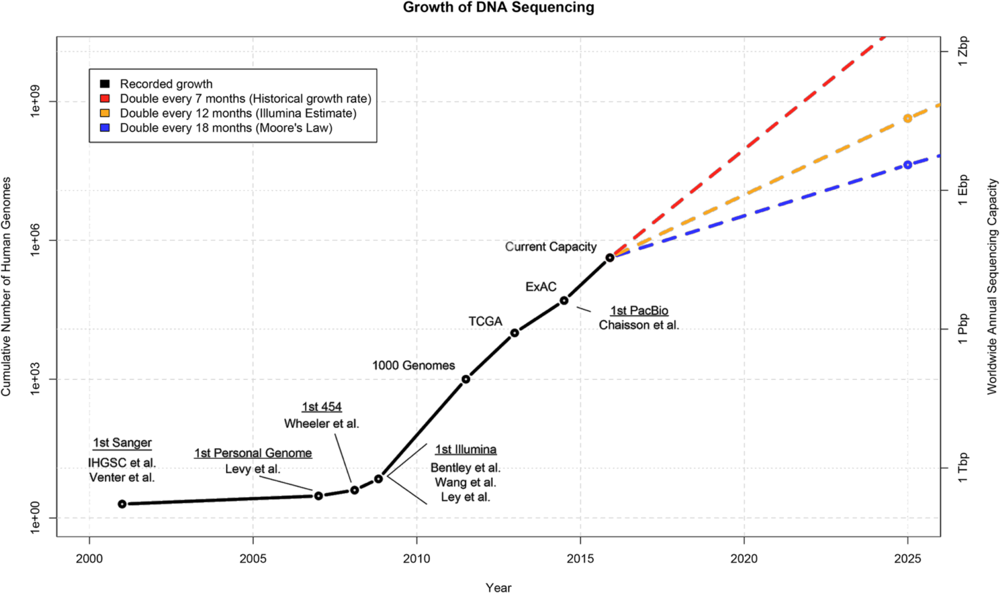
:::
::: {.column width="40%"}
::: {.small}
- Computing power per dollar has kept roughly doubling every two years
- Sequencing got cheaper, but computers do not keep up: storing and analysing the data becomes as hard as producing it
- 2015 projection: 100 million to 2 billion genomes by 2025. Reality: a few million

First human genome: 13 years. SciLifeLab 2016: 1 h
:::
:::
::::

::: {.small}
Stephens ZD et al. (2015) [Big Data: Astronomical or Genomical?](https://doi.org/10.1371/journal.pbio.1002195) PLoS Biol 13:e1002195 (CC BY 4.0)
:::

::: {.notes}
Stephens and colleagues compared genomics with other big-data fields in 2015. Their 2015 projection was that between 100 million and 2 billion human genomes could be sequenced by 2025; that year has now passed, and the real number is not known precisely. They argued that storing and analysing the data would become as big a challenge as producing it, which is why the bioinformatics part of this course matters.
:::

## What can we do with it?

:::: {.columns}
::: {.column width="35%"}
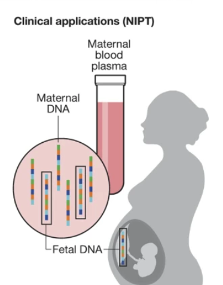{height="460"}
:::
::: {.column width="65%"}
- **Non-invasive prenatal testing:** fetal DNA in the mother's blood is sequenced
- The film *Gattaca* (1997) imagined genetic profiling at birth, less than 30 years ago 
:::
::::

::: {.small}
NIPT panel: Shendure et al. (2017) [DNA sequencing at 40](https://doi.org/10.1038/nature24286), Nature 550:345 (© Springer Nature)
:::

::: {.notes}
Sequencing has moved into the clinic. In non-invasive prenatal testing, the small amount of cell-free fetal DNA in the mother's blood, which mostly comes from the placenta, is sequenced to screen for chromosomal conditions; a positive screen is confirmed with an invasive test. Gattaca, from 1997, imagined a society that sorts people by their genome at birth. That was less than 30 years ago. It is worth discussing where the line should be.
:::

# Preparing DNA and RNA

Turn the sample into a library

::: {.notes}
Before any sequencing, the sample has to become a library: fragments of the right size with adapters on both ends.
:::

## From sample to library

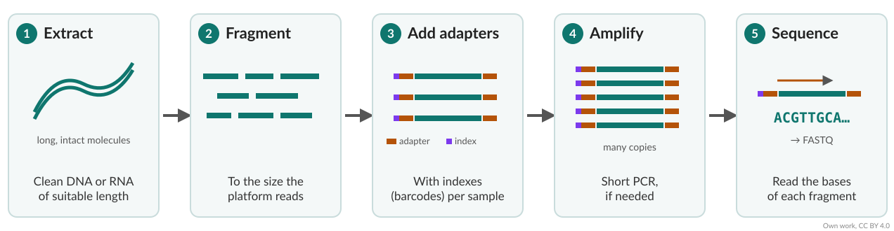

- The extraction method decides what is possible later: purity, fragment length, RNA integrity
- Long reads need high-molecular-weight DNA: no vortexing, no PCR; HiFi sheared to 15–20 kb, ultra-long not sheared

::: {.notes}
Library preparation turns your sample into molecules the sequencer can read. Extraction quality matters: fragment length and purity limit what you can do later, especially for long reads. The DNA is fragmented to the size the platform reads, adapters are added, usually with sample barcodes called indexes, and often a short PCR follows. For long reads we avoid PCR, and shear only gently: PacBio HiFi libraries are sheared to 15 to 20 kb, while ONT ultra-long protocols skip shearing altogether.
:::

## Fragmenting DNA

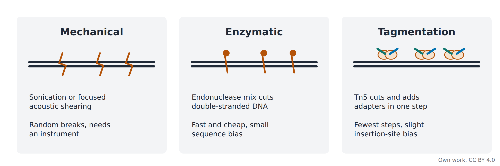

::: {.notes}
There are three common ways to fragment DNA. Mechanical shearing with sonication or focused acoustic energy, for example Covaris, gives random breaks but needs an instrument. Enzymatic fragmentation uses an endonuclease mix: fast and cheap, with a small sequence bias. Tagmentation, next slide, fragments the DNA and adds adapters in one step.
:::

## Tagmentation

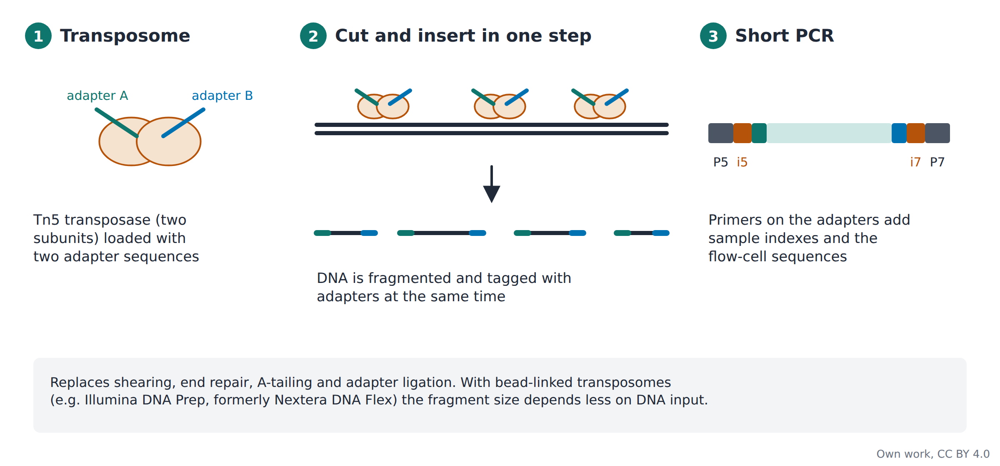

::: {.notes}
Tagmentation uses a modified Tn5 transposase loaded with two adapter sequences. It cuts the DNA and pastes the adapters onto the ends in one step. A short PCR then adds the sample indexes and the flow-cell binding sequences. It replaces four steps of classic library prep. Illumina's version is now called Illumina DNA Prep, formerly Nextera DNA Flex; there the transposomes sit on beads, which makes fragment size less sensitive to how much DNA you put in. Because each fragment gets a random pair of the two adapters, some fragments end up with the same adapter at both ends; those do not amplify properly and are lost.
:::

## From RNA to a library

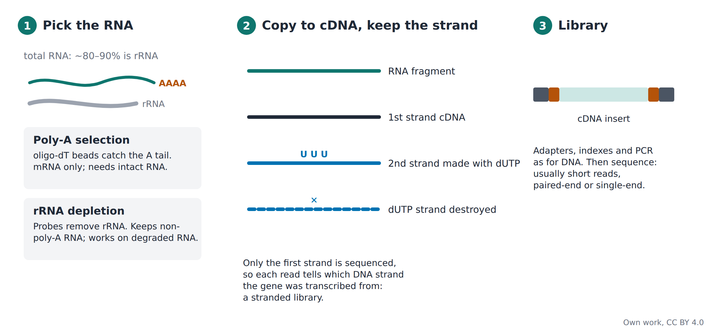

::: {.notes}
For RNA-seq, the first choice is which RNA to keep, because 80 to 90 percent of total RNA is ribosomal. Poly-A selection catches mRNA by its tail with oligo-dT beads; it needs intact RNA. rRNA depletion removes ribosomal RNA with probes; it keeps non-polyadenylated RNA and works on degraded samples such as FFPE. The RNA is fragmented and copied to cDNA. In a stranded library the second strand is made with dUTP and destroyed, so each read tells which strand the gene was transcribed from. After that, adapters, indexes and PCR are as for DNA.
:::

## Read types

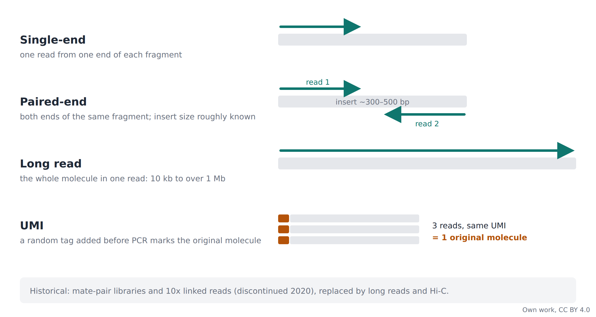

::: {.notes}
Single-end sequencing reads one end of each fragment. Paired-end reads both ends, so we know the two reads are a fixed distance apart, which helps mapping and finding structural variants. Long reads cover a whole molecule in one go. Unique molecular identifiers are random tags added before PCR; reads with the same UMI come from the same original molecule, so PCR copies can be collapsed, which matters for quantification. Mate-pair libraries and 10x Genomics linked reads, discontinued in 2020, have been replaced by long reads and Hi-C.
:::

# Short-read sequencing

Illumina sequencing by synthesis, and instruments

::: {.notes}
Now the short-read platforms, mainly Illumina, since that is where most data come from, including the cassava reads in today's exercises.
:::

## Illumina: sequencing by synthesis

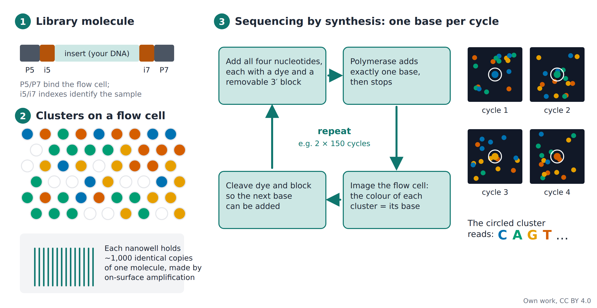

::: {.notes}
The library molecule has flow-cell binding sites, P5 and P7, and sample indexes. On the flow cell each molecule is copied about a thousand times in place, forming a cluster in a nanowell. Then each cycle adds all four nucleotides, each with a removable block so the polymerase adds exactly one base, and labelled so that each base gives its own signal; in two-colour chemistry G carries no dye at all. The instrument images the flow cell, the colour of each cluster gives its base, the dye and block are cleaved, and the cycle repeats, for example 2 times 150 cycles.
:::

## Illumina sequencing by synthesis

Watch the following video to understand Illumina's sequencing by synthesis:

[**▶ Overview of Illumina Sequencing by Synthesis Workflow**](https://www.youtube.com/watch?v=fCd6B5HRaZ8){target="_blank"}

Illumina, on YouTube

::: {.small}
Video: © Illumina, Inc.
:::

::: {.notes}
Click the link to open Illumina's own animation on YouTube. It shows standard SBS chemistry: cluster generation by bridge amplification, then cycles of nucleotide addition, imaging and cleavage. The NovaSeq X works the same way in principle but uses patterned flow cells with exclusion amplification and the newer XLEAP chemistry. Opens in the browser.
:::

## This is how it looks

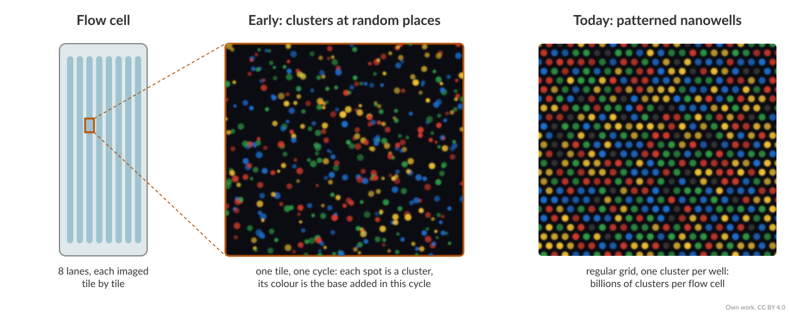

::: {.small}
- Lanes are imaged tile by tile
- Each spot is one cluster; colour = base in this cycle
- Early flow cells: clusters at random positions. Today: patterned nanowells, billions of clusters
:::

::: {.notes}
A flow cell is a glass slide with lanes. The camera images it tile by tile, and each tile shows thousands of clusters as coloured spots. On early, non-patterned flow cells, clusters grow at random positions. Current patterned flow cells put the clusters into a regular grid of nanowells; a 25B flow cell holds billions of clusters. With exclusion amplification, free adapters left in the library can cause slightly more index hopping, between 0.1 and 2 percent of reads; unique dual indexes let you filter those reads out.
:::

## Improvements: two-colour chemistry

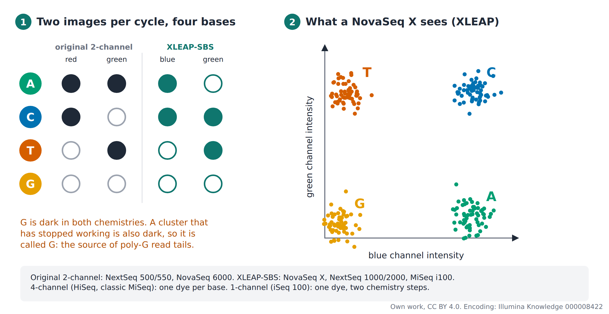

::: {.small}
Figure: own work, CC BY 4.0; colour encoding: Illumina Knowledge article 000008422
:::

::: {.notes}
Most current Illumina instruments use two images per cycle instead of four. In the original two-colour chemistry of the NextSeq 500 and NovaSeq 6000, A is bright in both channels. In XLEAP-SBS, used on the NovaSeq X, NextSeq 1000 and 2000 and MiSeq i100, C is the base seen in both channels, A only in blue, T only in green. In both, G is dark. That saves time, but a cluster that has stopped working is also dark and is called G. This is why reads from NextSeq and NovaSeq often end in long runs of G, which have to be trimmed. The older 4-channel and the iSeq's 1-channel chemistry follow the same idea with different encodings.
:::

# Long-read sequencing

::: {.notes}
Now the long-read platforms: PacBio and Oxford Nanopore.
:::

## Third generation: single molecules, long reads

|  | PacBio HiFi | Oxford Nanopore |
|--|-------------|-----------------|
| **How** | Polymerase copies a circular template, watched in real time | Strand pulled through a protein pore, current is measured |
| **Length** | 15–20 kb | As long as the molecule, up to > 1 Mb |
| **Accuracy** | Typically Q30 (99.9%) | ~Q26 (99.75%) per read |

**Both:** no PCR needed, and methylation is read directly from the native molecule.

::: {.callout-note}
- Q20 = 1 error in 100 bases 
- Q30 = 1 in 1,000 
- Q40 = 1 in 10,000. 

Accuracy: manufacturer specifications (PacBio 2024, Oxford Nanopore 2025)
:::

::: {.notes}
Third-generation platforms read single molecules without amplification. PacBio watches a polymerase copy a circular template many times, which gives HiFi reads that are both long and very accurate. Oxford Nanopore pulls a single DNA or RNA strand through a protein pore and reads the change in electric current. Note: ONT is strand sequencing; the older 'sequencing by cleavage' idea was abandoned. Both detect base modifications such as methylation directly.
:::

## PacBio: single-molecule real-time sequencing

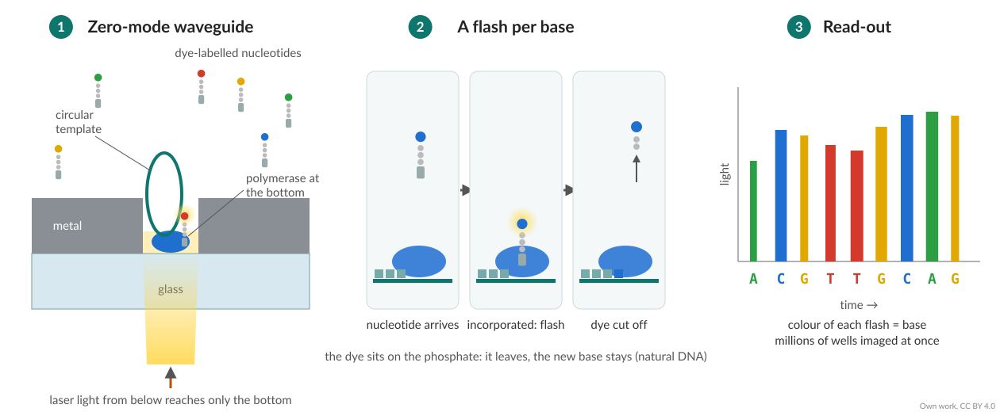

::: {.small}
- A polymerase sits at the bottom of a zero-mode waveguide
- Dye on the phosphate: a flash per added base, then the dye is cut off
- Revio: 25 million wells per SMRT Cell
:::

::: {.notes}
The key part is the zero-mode waveguide, a well so small that light only reaches its bottom, where a single polymerase sits. Each nucleotide carries its dye on the phosphate. When the polymerase incorporates a base, the dye flashes in the light, and it is cut off with the phosphate, leaving natural DNA. A Revio SMRT Cell has 25 million of these wells.
:::

## PacBio HiFi: accuracy from repetition

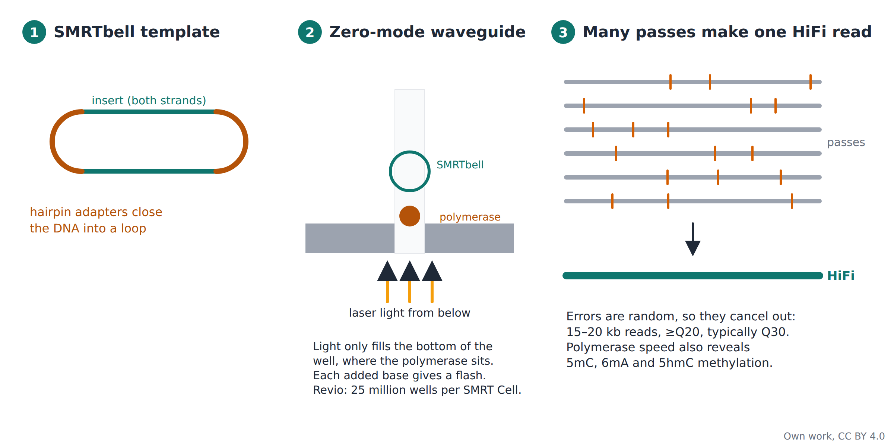

::: {.small}
Figure: own work, CC BY 4.0. Revio SPRQ-Nx: ~\$345 list, < \$300 at scale per HiFi human genome (PacBio press release, 26 May 2026)
:::

::: {.notes}
The template is a SMRTbell: double-stranded DNA closed by hairpin adapters into a loop. The polymerase goes round and round, so each molecule is read many times. Single passes have random errors, but because they are random they cancel out in the consensus, giving HiFi reads of 15 to 20 kb. HiFi is defined as at least 99 percent accurate, Q20, and most HiFi bases reach Q30. The Revio with the new SPRQ-Nx chemistry, shipping since May 2026, lists about 345 dollars per human HiFi genome and under 300 at scale; Vega is the benchtop version.
:::

## Oxford Nanopore

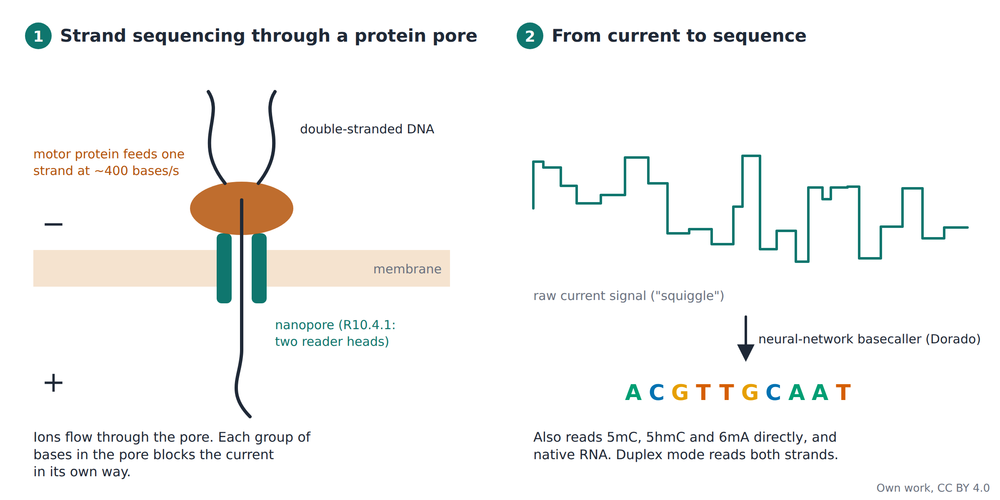

::: {.small}
Figure: own work, CC BY 4.0. Accuracy: nanoporetech.com/platform/accuracy (accessed Oct 2026)
:::

::: {.notes}
A motor protein unwinds the DNA and feeds one strand through a protein pore in a membrane, at about 400 bases per second. Ions flow through the pore, and each group of bases in the pore blocks the current in its own way. A neural-network basecaller, Dorado, turns this current trace, the squiggle, into bases. With R10.4.1 pores and Kit 14, ONT reports a modal single-read accuracy of 99.75 percent with its most accurate basecalling model; duplex mode reads both strands for higher accuracy. The same signal reveals methylation, and RNA can be read directly.
:::

## Long reads for RNA: whole transcripts

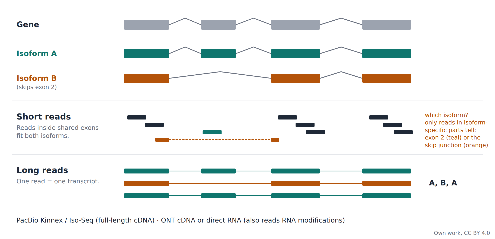

::: {.notes}
Most genes make more than one transcript isoform. With short reads, a read inside a shared exon fits every isoform, so isoforms have to be inferred statistically; only reads in the parts that differ, an exon used by one isoform only or a junction that skips it, tell them apart. Long reads cover the whole transcript, so each read shows directly which isoform it came from. PacBio Kinnex and Iso-Seq sequence full-length cDNA; ONT can sequence cDNA or the native RNA itself, which also reveals RNA modifications such as m6A.
:::

## Short fragments can take over a long-read run

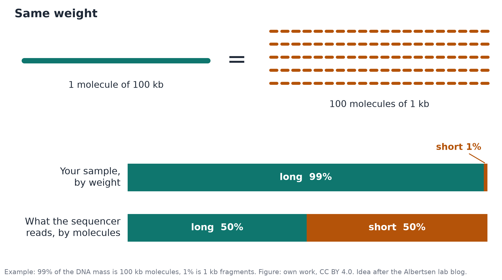

::: {.small}
Figure: own work, CC BY 4.0. Idea after a post on the Albertsen lab blog (Aalborg University; no longer online)
:::

::: {.notes}
The same mass of DNA contains far fewer long molecules than short ones. One microgram of 350 bp fragments has about 2.6 times 10 to the 12 molecules; one microgram of 100 kb fragments only about 10 to the 10. So a small amount of short DNA by mass can dominate by molecule count. Example: if 1 percent of the mass is 1 kb fragments and 99 percent is 100 kb, about half of all molecules are short, and short molecules get sequenced too. Idea after the Albertsen lab blog.
:::

## Getting long DNA: pulsed-field gel electrophoresis

:::: {.columns}
::: {.column width="45%"}
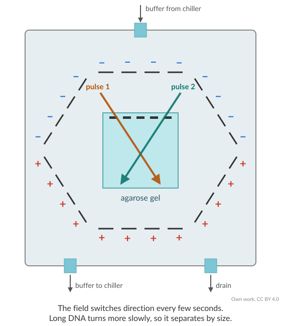{height="520"}
:::
::: {.column width="55%"}
- Gentle extraction: high-molecular-weight DNA
- Fragments > 15–20 kb run together on a normal gel: use pulsed-field gels
- Remove short fragments: gel-based (BluePippin, cut-off ~10–15 kb) or bead-based kits
:::
::::

::: {.notes}
Long reads need long DNA. Extraction has to be gentle: no vortexing, wide-bore tips. On a normal agarose gel, everything above 15 to 20 kb runs together, so pulsed-field gel electrophoresis, which switches the field direction, is used to check size. To get rid of short fragments, which would otherwise take a large share of the reads, you can size-select on a gel-based system such as BluePippin, or use bead-based short-read eliminator kits.
:::

## Read-length distributions and N50

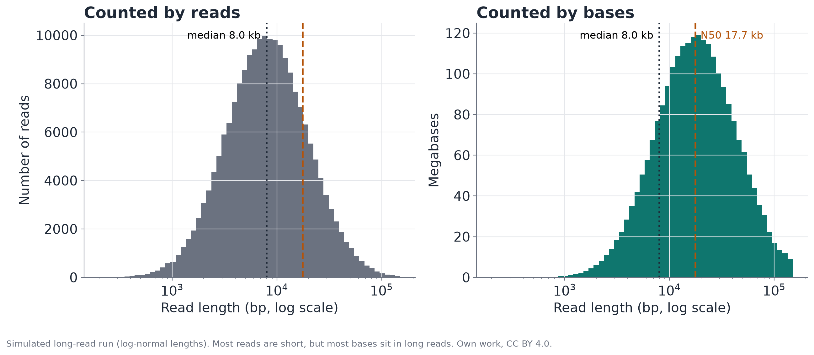

**N50:** half of all bases are in reads at least this long.

::: {.small}
Simulated data. Figure: own work, CC BY 4.0
:::

::: {.notes}
Long-read runs are summarised with N50: half of all sequenced bases are in reads at least this long. Counted by reads, most reads are fairly short; counted by bases, most of the data sits in the long reads. Here the median read is 8 kb, but the N50 is almost 18 kb. Always check which of the two a report shows.
:::

# Choosing a platform

Strengths and typical errors

::: {.notes}
Finally: how to choose between platforms, which errors to expect, and what changed recently.
:::

## Which platform for which question?

::: {.small}
|  | Illumina NovaSeq X | Element AVITI | PacBio Revio (HiFi) | Oxford Nanopore |
|--|--|--|--|--|
| **Read length** | 2 × 150 bp | 2 × 150 bp | 15–20 kb | As long as the molecule: ~100 bp to > 1 Mb |
| **Accuracy** | Q30+ | Q30+ (Q40+ with UltraQ) | Q20+, typically Q30 | Q20–Q26 per read (duplex Q30) |
| **Best for** | Large cohorts, RNA-seq counts, lowest cost per base | Very accurate short reads | Genome assembly, phasing, full-length isoforms | Longest reads, structural variants, direct RNA, field work |
:::

Short reads are cheap and plentiful, long reads span repeats and whole transcripts.

::: {.small}
Manufacturer specifications, 2024–2026
:::

::: {.notes}
A rough guide. Illumina is the default for counting: RNA-seq expression, large cohorts, and anything where cost per base matters. Element AVITI gives very accurate short reads. PacBio HiFi is the choice for genome assembly, phasing and full-length isoforms. Oxford Nanopore gives the longest reads, structural variants, direct RNA, and works in the field. Accuracy values are manufacturer specifications.
:::

## Typical errors and where they come from

:::: {.columns}
::: {.column width="50%"}
::: {.callout-warning appearance="simple" icon="false"}
**Homopolymers.** AAAAAAA miscounted → false insertions or deletions. Worst on ONT.  
*Not in FastQC: shows up in variant calls*
:::

::: {.callout-warning appearance="simple" icon="false"}
**GC bias.** GC-rich or GC-poor regions get fewer reads.  
*FastQC: per sequence GC content*
:::

::: {.callout-warning appearance="simple" icon="false"}
**Poly-G and adapters.** "No signal" is called G; short inserts read into the adapter.  
*FastQC: adapter content → trim*
:::

:::
::: {.column width="50%"}
::: {.callout-warning appearance="simple" icon="false"}
**Duplicates.** PCR copies inflate coverage. Normal for highly expressed genes.  
*FastQC: sequence duplication levels*
:::

::: {.callout-warning appearance="simple" icon="false"}
**Index hopping.** Reads land in the wrong sample.  
*Prevent with unique dual indexes*
:::

::: {.callout-tip appearance="simple" icon="false"}
**Artefact or biology?** Think of the technical explanation first.  
*→ QC lecture and today's exercises*
:::

:::
::::

::: {.small}
Höjer et al. (2026) NAR Genom Bioinform 8:lqag053; Illumina and Oxford Nanopore technical notes
:::

::: {.notes}
Each error type matters for analysis, and most of them show up in the FastQC and MultiQC reports you will look at in today's exercises. Homopolymer errors create false insertions and deletions; they do not show in FastQC but in variant calls. GC bias leaves GC-rich regions such as promoters and first exons with few reads. Poly-G tails and adapter read-through stop reads mapping and are trimmed by fastp or Trim Galore. Duplicates inflate counts, but in RNA-seq highly expressed genes naturally give many. Index hopping puts reads into the wrong sample. Always think of the technical explanation before the biological one.
:::

# News and outlook

New developments and sequencing in Sweden

::: {.notes}
To finish: what changed recently, and where to sequence in Sweden.
:::

## What's new in 2026

- **Roche AXELIOS 1 / SBX (June 2026):** DNA copied into a ~50× longer polymer, read through a nanopore; same-day genomes claimed (research use)
- **Ultima UG 200 (Feb 2026):** open spinning wafer instead of a flow cell; twice the output of the UG 100, half the run time
- **Element VITARI (H2 2026):** high-throughput instrument, up to 10 billion reads per run; ~\$100 genome claimed
- **PacBio SPRQ-Nx (May 2026):** HiFi human genome ~\$345 list, < \$300 at scale; adds 5hmC

::: {.small}
Roche release 29 Jun 2026; Ultima (GEN, 23 Feb 2026); Element 2026 roadmap; PacBio release 26 May 2026 (all manufacturer claims)
:::

::: {.notes}
Four developments worth knowing. Roche launched its AXELIOS 1 instrument with SBX, sequencing by expansion, in June 2026, for research use: DNA is copied into a surrogate polymer about 50 times longer and read through a nanopore, with same-day genomes claimed. Ultima's UG 200, launched in February 2026, keeps the open spinning wafer of the UG 100 with twice the output and half the run time. Element plans VITARI, a high-throughput instrument claiming a 100-dollar genome, for the second half of 2026. PacBio's SPRQ-Nx chemistry brings HiFi genomes under 300 dollars at scale. All of these are manufacturer claims, not independent benchmarks.
:::

## Sequencing in Sweden: NGI

- **Illumina NovaSeq X:** short reads at scale
- **Element AVITI / AVITI24:** accurate short reads, in situ
- **PacBio Revio:** HiFi long reads
- **ONT PromethION:** ultra-long reads, direct RNA

National Genomics Infrastructure (SciLifeLab): Stockholm and Uppsala nodes. Ask them for advice on study design before you sequence: [ngisweden.scilifelab.se](https://ngisweden.scilifelab.se){target="_blank"}

::: {.small}
NGI Sweden methods and technologies pages (accessed Oct 2026)
:::

::: {.notes}
If you sequence in Sweden, you will probably work with the National Genomics Infrastructure at SciLifeLab, with nodes in Stockholm and Uppsala. NGI runs most of the platforms in this lecture, so you can choose by question rather than by what is available. They also advise on study design before you sequence; use that.
:::

## Learn more

::: {.small}
- Shendure J et al. (2017) [DNA sequencing at 40: past, present and future](https://doi.org/10.1038/nature24286). Nature 550:345–353
- Satam H et al. (2023) [Next-generation sequencing technology: current trends and advancements](https://doi.org/10.3390/biology12070997). Biology 12:997 (open access; correction: Biology 2024, 13:286)
- Marx V (2023) [Method of the year: long-read sequencing](https://doi.org/10.1038/s41592-022-01730-w). Nature Methods 20:6–11
- Höjer P et al. (2026) [Whole-genome sequencing with AVITI and NovaSeq X Plus reveals comparable performance with contextual biases](https://academic.oup.com/nargab/article/8/2/lqag053/8693987). NAR Genom Bioinform 8:lqag053
- Stephens ZD et al. (2015) [Big Data: Astronomical or Genomical?](https://doi.org/10.1371/journal.pbio.1002195) PLoS Biol 13:e1002195
- Goodwin S et al. (2016) [Coming of age: ten years of next-generation sequencing technologies](https://doi.org/10.1038/nrg.2016.49). Nat Rev Genet 17:333
:::

::: {.notes}
These are good starting points. Shendure and colleagues give the history and outlook. Satam and colleagues is an open-access overview of current technologies. Nature Methods named long-read sequencing Method of the Year 2022; Vivien Marx's feature explains why. Höjer and colleagues is the Swedish platform comparison. Goodwin and colleagues is the classic review, now partly historical.
:::

## Image credits

::: {.small}
- Own work (CC BY 4.0): sample to library, pulsed-field gel, PacBio zero-mode waveguide, flow cell, Sanger workflow, gel and trace, chain termination, fragmentation, tagmentation, RNA library, Illumina SBS, two-colour chemistry, read types, PacBio HiFi, nanopore, isoforms, molecule count, read-length and N50 figures
- Cost per genome: data NHGRI via Our World in Data (CC BY 4.0)
- Growth of sequencing: Stephens et al. 2015, PLoS Biol (CC BY 4.0)
- NIPT panel: Shendure et al. 2017, Nature (© Springer Nature)
:::
