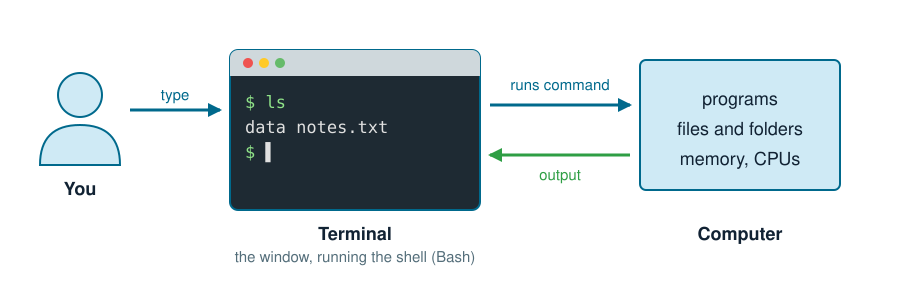
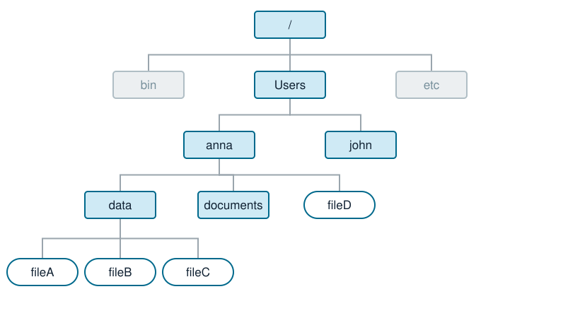
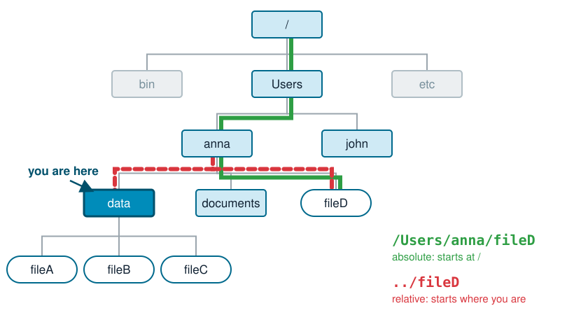

## This lecture

1. What is a shell, and why use it?
2. Files and folders: the directory tree
3. Paths: where am I, where is my file?
4. The command syntax
5. Today's commands
6. Wildcards, redirection and pipes
7. Next: the server

::: {.small}
Adapted from *Introduction to UNIX* by Renaud Van Damme (SLU).
:::

# What is a shell?

## Make your computer understand 

[]{style="display:block; height:1.5em"}

:::: {.columns}
::: {.column width="50%"}
**Graphical interface**

- click on folders and files
- easy to start with
- hard to repeat: 100 files means 100 clicks
:::
::: {.column width="50%"}
**Command line (shell)**

- type a command, read the answer
- takes some learning
- one command can handle 100 files, and you can save it in a script
:::
::::

. . .


You can mix and match these on the same files and folders.

::: notes
Open Finder/Explorer and a terminal side by side on the same folder. Create a folder in the terminal and show it appear in the file browser.
:::

## The shell



- The **terminal** is the window; the **shell** is the program inside it that reads your commands.
- We use **Bash**, the shell on most Linux servers. macOS uses zsh by default, which works almost the same.

## Bioinformaticians use it

[]{style="display:block; height:1.5em"}

- Almost all servers and clusters run **Linux**, and you reach them only through a shell.
- Most bioinformatics tools have no graphical interface: they are commands.
- Files are huge: you cannot open a 10 GB FASTQ file in a word processor.
- Commands can be saved in scripts: your analysis becomes repeatable and documented.

# Files and folders

## The directory tree

{fig-align="center" width="85%"}

- Folders (also called **directories**) contain files and other folders.
- Everything starts at the **root**, written `/`.

::: notes
Linux and macOS have one tree starting at /. Git Bash shows the Windows C: drive as /c.
:::

## Your home folder

[]{style="display:block; height:1.5em"}

Each user has a home folder. This is the default location when the shell is started. It can be accessed by `~`.

[]{style="display:block; height:1.5em"}

| Where | Your home folder |
|---|---|
| macOS | `/Users/anna` |
| Git Bash on Windows | `/c/Users/anna` |
| Linux, WSL | `/home/anna` |
| HPC2N server | `/home/a/anna` |

[]{style="display:block; height:1.5em"}

Your Desktop is `~/Desktop`: today's data will be in `~/Desktop/shell-lesson-data`.

# Paths

## Where am I?

{fig-align="center" width="60%"}

- At every moment the shell is "in" one folder: the **working directory**.
- `pwd` (print working directory) tells you which one.
- Commands look for files **relative to where you are**, unless you say otherwise.

## Absolute and relative paths

{fig-align="center" width="80%"}

- **Absolute path**: starts at `/`, works from anywhere.
- **Relative path**: starts where you are. `..` is the folder above, `.` is the folder you are in.

::: notes
Ask: from data, what is the relative path to fileA? (fileA) From documents? (../data/fileA). Most errors students make later on the server are relative paths typed from the wrong folder.
:::

## Moving around with `cd`

[]{style="display:block; height:1.5em"}

| From | To | Command |
|---|---|---|
| anywhere | home | `cd` |
| anna | data | `cd data` |
| data | anna | `cd ..` |
| data | documents | `cd ../documents` |
| anywhere | Users | `cd /Users` |

[]{style="display:block; height:1.5em"}

::: {.fragment}
Lost? `pwd` tells you where you are, `ls` shows what is there.
:::

## Tips for paths

[]{style="display:block; height:1.5em"}

- Press <kbd>Tab</kbd> (`->|`) to complete file and folder names. This way, you will have fewer typos.  If nothing completes, the file is not where you think it is, or is called differently. 
- Avoid spaces in names: `my data.txt` is read as two files. Use `my_data.txt`.
- Remember: upper and lower case are different: `Data` is not `data`.

# Commands

## What a command looks like

<br>

::: {.big}
```{.bash}
ls -l -h Desktop/shell-lesson-data
```
:::

[]{style="display:block; height:1.5em"}

| Part | Here | Meaning |
|---|---|---|
| command | `ls` | the program to run |
| options | `-l -h` | change what it does; usually start with `-` |
| arguments | `Desktop/shell-lesson-data` | what to work on: often a path |

[]{style="display:block; height:1.5em"}

In the material, `$` stands for the prompt: do not type it.

## Getting help

[]{style="display:block; height:1.5em"}

```{.bash}
ls --help      # short help (Git Bash, Linux)
man ls         # full manual (macOS, Linux); quit with q
```

[]{style="display:block; height:1.5em"}

[explainshell.com](https://explainshell.com/) explains any command you paste into it.

## Commands for today

[]{style="display:block; height:1.5em"}

| Command | Does | Example |
|---|---|---|
| `pwd` | show where you are | `pwd` |
| `ls` | list a folder | `ls -F data` |
| `cd` | change folder | `cd ..` |
| `mkdir` | make a folder | `mkdir results` |
| `touch` | make an empty file | `touch notes.txt` |
| `cp` | copy | `cp a.txt b.txt` |
| `mv` | move or rename | `mv b.txt results/` |
| `rm` | delete, **for good** | `rm results/b.txt` |

## Reading and writing files

[]{style="display:block; height:1.5em"}

:::: {.columns}
::: {.column width="50%"}
**Read**

- `cat file`: print the whole file
- `head file`: the first 10 lines
- `less file`: scroll through, quit with <kbd>q</kbd>
- `wc -l file`: count lines
:::
::: {.column width="50%"}
**Write: `nano file`**

- a simple text editor inside the terminal
- <kbd>Ctrl</kbd> + <kbd>O</kbd>: save
- <kbd>Ctrl</kbd> + <kbd>X</kbd>: exit
- the shortcuts are listed at the bottom of the window
:::
::::

::: notes
Show nano live: open a file, type a line, save, exit, cat the file. On the server students write their job scripts with nano.
:::

## Remove files and directories

[]{style="display:block; height:1.5em"}

Usage: `rm test.txt`

- `rm` deletes immediately and permanently. The command line does not have a bin.
- `rm -r folder` deletes a folder and **everything** in it.
- Use `rm -i` to be asked before each file.

# Wildcards, redirection and pipes

## Wildcards: operate on several files

[]{style="display:block; height:1.5em"}

Example folders: 

`out1  out2  out3  out.4  in.f  in.o`

[]{style="display:block; height:1.5em"}

| Pattern | Matches |
|---|---|
| `*` | all files |
| `out*` | `out1 out2 out3 out.4` |
| `out?` | `out1 out2 out3` (exactly one character) |
| `*.f` | `in.f` |

[]{style="display:block; height:1.5em"}

```{.bash}
ls *.fastq            # all FASTQ files in this folder
```

## Saving and redirecting

[]{style="display:block; height:1.5em"}

| | Does | Example |
|---|---|---|
| `>` | save output to a file (overwrites!) | `ls > files.txt` |
| `>>` | add output to the end of a file | `ls >> files.txt` |
| `|` | send output into the next command | `ls | wc -l` |

[]{style="display:block; height:1.5em"}

```{.bash}
head -n 8 reads.fastq | less     # look at the first two reads
```

## Today

- Exercises: Software Carpentry *The Unix Shell*, episodes 1 to 4; bonus episode 6
- Discussion
- Lab quiz in Canvas

::: {.small}
Lesson: <https://swcarpentry.github.io/shell-novice/> 

Summary: <https://swcarpentry.github.io/shell-novice/reference.html>
:::
